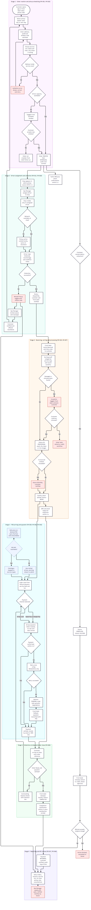
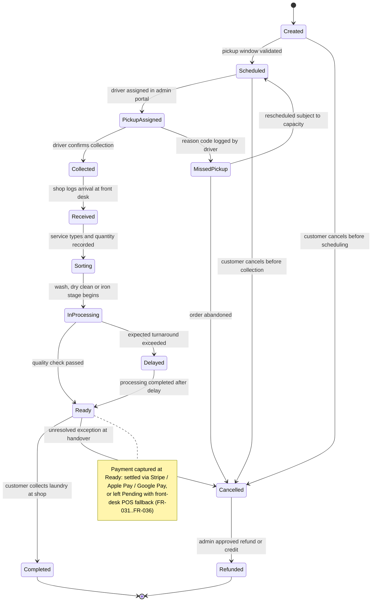
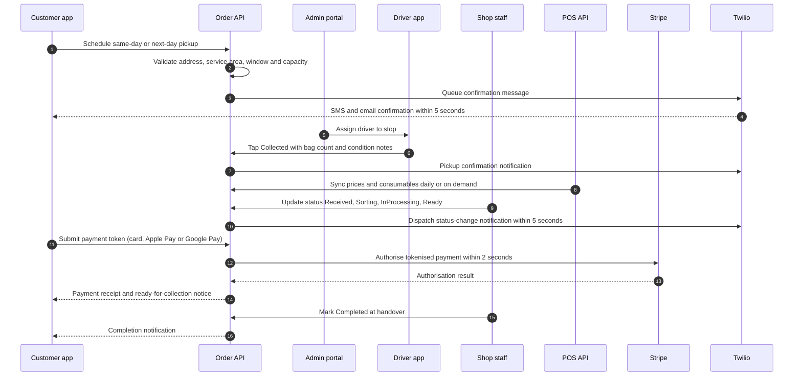
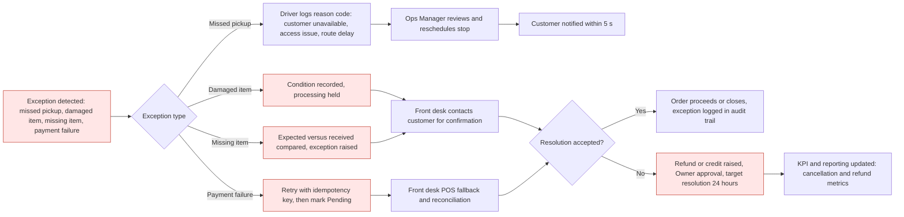

# Functional Specification Document

## Laundry Service Shop App — "WashLoop"

| Field | Detail |
|---|---|
| **Document Title** | Functional Requirements Specification — Laundry Service Shop App |
| **Document ID** | BS-001 |
| **Version** | 1.0 (Draft for review) |
| **Date** | 15 June |
| **Author(s)** | Senior Business Analyst (Functional Spec Writer Agent) |
| **Sponsor** | Laundry Service Shop Owner / Operations Manager |
| **Related Area** | Customer Operations, Logistics (Pickup), Payments, Mobile & Web |
| **Document Status** | IN PROGRESS — awaiting sign-off |
| **Platform** | Native iOS, Native Android, Lightweight Web Admin Portal |
| **Budget / Timeline** | $15,000 – $18,000 · 12 weeks |

### Document Approvers & Reviewers

| Name | Role | Approver / Reviewer | Approval / Review Date | Version |
|---|---|---|---|---|
| Shop Owner | Business Sponsor | Approver | TBD | 1.0 |
| Operations Manager | Operational Lead | Approver | TBD | 1.0 |
| Lead Developer | Technical Lead | Reviewer | TBD | 1.0 |
| QA Lead | Head of UAT | Approver | TBD | 1.0 |

### Reference Documents

- Interview Q&A record (Product Overview, KPIs, Scope, NFRs, Roles, Integrations, Constraints, Dependencies & Risks)
- Requirements Summary (summarizer_agent output)
- Existing POS system API documentation (to be validated — see Assumptions)

---

# 1. Introduction

## 1.1 Overview

WashLoop is a customer-facing and operations-facing application for a residential laundry service shop. It digitises the shop's end-to-end service flow: a customer schedules a pickup, a driver collects the laundry, shop staff process the items (wash & fold, dry cleaning, or ironing), the customer tracks the order in real time, and the customer pays for the service through Stripe, Apple Pay or Google Pay. SMS and email notifications keep the customer informed at every stage.

The solution consists of three deliverables:

1. **Customer mobile app** — native iOS and native Android.
2. **Operations workflow** — driver and sorting/front-desk staff update order status from the app.
3. **Web admin portal** — a lightweight browser-based console for order management, driver assignment, pricing/inventory sync with the existing POS, and operational reporting.

The shop currently handles approximately **57 orders per day (~400 orders per week)** for roughly **200 active customers per week**, with an average order value of **$30**, generating approximately **$1,710 gross revenue per day / $51,000 per month**. Peak order windows are **11:00–14:00** and **16:00–18:00**, reaching **10–12 orders per hour**.

## 1.2 Objectives

| # | Objective | Measure of Success |
|---|---|---|
| O1 | Replace manual/phone-based order intake with self-service scheduling | ≥ 70% of orders booked through the app by end of beta |
| O2 | Provide transparent, real-time order status to customers | Status updated within 2 seconds of the staff action; customer-visible |
| O3 | Reduce pickup no-shows and scheduling errors | On-time pickup rate ≥ 90% (target — to be ratified by owner) |
| O4 | Increase repeat usage | Repeat-order rate ≥ 40% of active customers per month (target — to be ratified) |
| O5 | Digitise payment collection | ≥ 95% payment success rate; PCI-DSS compliant |
| O6 | Give management operational visibility | Daily order, revenue and driver-utilisation dashboards available |

## 1.3 Business Benefits

- Fewer manual touchpoints and phone calls per order.
- Consistent pricing and inventory sourced from the existing POS system.
- Higher customer trust through status transparency and notification trails.
- Capacity to absorb peak-window demand without front-desk bottlenecks.
- Data foundation for future loyalty, delivery and routing features (v2 candidates).

---

# 2. Scope

## 2.1 In Scope (v1 / MVP)

| Area | Capability |
|---|---|
| Customer app | Account registration/login, pickup scheduling (same-day and next-day), service-type selection (wash & fold, dry clean, ironing), order creation, order status tracking, in-app payment, notification settings |
| Payments | Stripe integration, Apple Pay and Google Pay via Stripe; order-level refunds initiated by admin |
| Notifications | SMS (Twilio) and email notifications for order confirmation, pickup confirmation, status change and completion |
| Operations | Driver pickup assignment, pickup-completed marking, staff status updates through a defined status lifecycle |
| Web admin portal | Order queue management, driver assignment, pricing and inventory sync from POS, basic operational and revenue reporting |
| Integrations | Stripe, Twilio, existing POS API (pricing and inventory), Apple/Google payment sheets |
| Platforms | iOS app, Android app, responsive web portal (Chrome/Edge/Safari) |
| Data & security | Customer PII storage, PCI-DSS compliant payment token handling, role-based access control |

## 2.2 Out of Scope (v1)

> **Note:** The items below were raised during the requirements interview but **not explicitly confirmed** by the business owner. They are recorded here as **assumed out of scope for v1** and must be ratified before development starts. See Section 7.

| Item | Status in v1 | Rationale |
|---|---|---|
| Home return / delivery of cleaned laundry | Assumed OUT (customer collection only) | Not confirmed by owner |
| Loyalty / referral / points programme | OUT | Deferred to v2 |
| Insurance, damage or lost-item claims workflow | OUT | Exception handling not defined |
| Driver GPS routing / live vehicle tracking | OUT | Deferred to v2 |
| Self-service drop-off at shop | OUT | Not part of confirmed flow |
| Multi-location / franchise support | OUT | Single shop assumed |
| Advanced analytics & BI | OUT | Basic reporting only |
| Offline-first driver mode with sync | Assumed OUT (limited resilience required) | Not confirmed |
| Subscriptions / recurring weekly plans | OUT | Deferred |

## 2.3 Systems & Platforms

| System | Type | Notes |
|---|---|---|
| iOS app | Native (iOS 15+) | App Store distribution |
| Android app | Native (Android 10+) | Play Store distribution |
| Web admin portal | Responsive web app | Lightweight; admin + front-desk use |
| Backend API | Cloud-hosted REST API | ≥ 15 req/s peak capacity |
| Stripe | External payment gateway | Cards, Apple Pay, Google Pay |
| Twilio | External SMS/OTP gateway | Notification dispatch |
| Existing POS | External system | Pricing & inventory sync |

---
# 3. Functional Requirements

> **Priority scheme:** MoSCoW — **Must** (v1 mandatory), **Should** (v1, deferrable within a sprint), **Could** (nice-to-have), **Won't** (explicitly deferred to v2 or beyond).
> **Source column** identifies the stakeholder who raised the requirement.

## 3.1 Ordering & Pickup Scheduling

| ID | Requirement | Priority | Source |
|---|---|---|---|
| FR-001 | The system shall allow a registered customer to create an order requesting a laundry pickup. | Must | Owner |
| FR-002 | The system shall offer both **same-day** and **next-day** pickup options at order creation. | Must | Owner |
| FR-003 | The system shall let the customer select one or more service types: Wash & Fold, Dry Cleaning, Ironing, or a mixed load. | Must | Owner |
| FR-004 | The system shall capture the pickup address, contact phone number, preferred pickup window, and estimated load (bags / items). | Must | Owner |
| FR-005 | The system shall validate the pickup address against the defined service area before confirming the order. | Must | Ops Manager |
| FR-006 | The system shall reject or re-schedule a pickup request when the selected window exceeds available driver capacity. | Should | Ops Manager |
| FR-007 | The system shall suggest the next available pickup window when the requested window is unavailable. | Should | Ops Manager |
| FR-008 | The system shall allow a customer to cancel a scheduled pickup **before collection**, and shall record the cancellation reason. | Must | Owner |
| FR-009 | The system shall allow a customer to reschedule a pickup window subject to capacity. | Should | Ops Manager |
| FR-010 | The system shall record an audit trail (user, timestamp, change) for every order lifecycle change. | Must | Ops Manager |

## 3.2 Driver & Collection Workflow

| ID | Requirement | Priority | Source |
|---|---|---|---|
| FR-011 | The admin portal shall display a pickup queue of all scheduled collection stops for a given day. | Must | Ops Manager |
| FR-012 | The admin portal shall allow a driver to be assigned to each pickup stop. | Must | Ops Manager |
| FR-013 | The driver app shall show only the stops assigned to that driver for their shift. | Must | Driver lead |
| FR-014 | The driver shall be able to confirm a collection with a single action, moving the order status to **Collected**. | Must | Driver lead |
| FR-015 | The driver shall be able to record the number of bags/items collected and any observed condition notes. | Should | Ops Manager |
| FR-016 | The driver shall be able to log a **Missed Pickup** exception with a reason code (customer unavailable, access issue, route delay). | Must | Ops Manager |
| FR-017 | The system shall automatically notify the customer when a pickup is missed and offer a reschedule. | Must | Owner |
| FR-018 | The driver app shall retain locally captured pickup actions when connectivity is lost and synchronise them on reconnection. *(Assumed requirement — see Assumption A6)* | Could | Ops Manager |

## 3.3 Shop Processing & Order Status Lifecycle

| ID | Requirement | Priority | Source |
|---|---|---|---|
| FR-019 | The system shall support the order status lifecycle: **Created → Scheduled → Pickup Assigned → Collected → Received → Sorting → In Processing → Ready → Completed / Cancelled**. | Must | Ops Manager |
| FR-020 | Shop staff shall be able to mark an order as **Received** at the shop and link it to the customer. | Must | Front desk |
| FR-021 | Sorting staff shall be able to categorise the load by service type (Wash & Fold / Dry Cleaning / Ironing) and record quantity. | Must | Shop staff |
| FR-022 | Shop staff shall be able to update processing progress (washing, drying, ironing, finished). | Must | Shop staff |
| FR-023 | The system shall flag orders as **Delayed** when they exceed the expected turnaround window. | Should | Ops Manager |
| FR-024 | The system shall allow staff to log a **damaged item** or **missing item** exception against an order, with a description. | Must | Front desk |
| FR-025 | The system shall support a front-desk lookup of an order by order number, customer name, phone number, or bag tag. | Must | Front desk |
| FR-026 | Front-desk staff shall be able to verify, release and mark an order **Completed** when the customer collects it. | Must | Front desk |
| FR-027 | The customer shall be able to view the current order status, service type, and processing stage in real time from the app. | Must | Owner |

## 3.4 Payments

| ID | Requirement | Priority | Source |
|---|---|---|---|
| FR-028 | The system shall accept payment through **Stripe** (card), **Apple Pay**, and **Google Pay**. | Must | Owner |
| FR-029 | The system shall calculate the order total from service types and pricing synchronised from the POS API, including applicable taxes and service fees. | Must | Owner |
| FR-030 | The system shall handle payment either at scheduling or before collection release, and shall clearly display the outstanding balance. | Must | Front desk |
| FR-031 | The payment flow shall complete in **≤ 2 seconds** under normal load. | Must | Owner |
| FR-032 | All card data shall be handled via Stripe payment tokens; the application shall **not** store raw card numbers. | Must | Technical lead |
| FR-033 | The system shall support a partial or full refund initiated by an authorised admin or front-desk user. *(Workflow detail unconfirmed — see Assumption A3)* | Should | Owner |
| FR-034 | The system shall record payment status (Paid, Pending, Failed, Refunded) on every order and expose it to the admin portal. | Must | Ops Manager |
| FR-035 | The system shall retry or fail gracefully a payment attempt without creating a duplicate transaction. | Must | Technical lead |
| FR-036 | The system shall issue a payment receipt to the customer by email and/or SMS link. | Should | Owner |

## 3.5 Notifications

| ID | Requirement | Priority | Source |
|---|---|---|---|
| FR-037 | The system shall send **SMS** notifications through **Twilio** and **email** notifications for key order events: confirmation, pickup confirmation, status change, ready-for-collection, and completion. | Must | Owner |
| FR-038 | Notifications shall be dispatched within **5 seconds** of the triggering status change. | Must | Owner |
| FR-039 | The notification service shall sustain approximately **1 message/second** in normal operation and **5 messages/second** at peak. | Must | Technical lead |
| FR-040 | Customers shall be able to choose their preferred notification channel (SMS, email, or both) and opt out of marketing messages. | Must | Owner |
| FR-041 | The system shall log notification delivery status (sent / failed) and retry failed SMS delivery once. | Should | Ops Manager |
| FR-042 | The system shall send an in-app push notification alongside SMS for app-installed customers. | Could | Owner |

## 3.6 Web Admin Portal & Reporting

| ID | Requirement | Priority | Source |
|---|---|---|---|
| FR-043 | The admin portal shall present a filtered, sortable order queue with status, date, service type, and payment status. | Must | Owner |
| FR-044 | The admin portal shall allow manual order creation and edit by front-desk staff. | Must | Front desk |
| FR-045 | The admin portal shall support driver assignment and reassignment. | Must | Ops Manager |
| FR-046 | The admin portal shall synchronise **prices and inventory/consumables** with the existing POS API at least daily, with on-demand refresh. | Must | Owner |
| FR-047 | The admin portal shall display basic operational reports: daily orders, revenue, service-type mix, on-time pickup rate, and cancellations. | Must | Owner |
| FR-048 | The admin portal shall expose KPI dashboards for the metrics defined in Section 5.3. | Should | Owner |
| FR-049 | The admin portal shall be usable on desktop and tablet browsers (Chrome, Edge, Safari). | Must | Technical lead |
| FR-050 | The admin portal shall enforce role-based access (Admin, Ops Manager, Front Desk) and log privileged actions. | Must | Technical lead |

## 3.7 Accounts, Access & Integrations

| ID | Requirement | Priority | Source |
|---|---|---|---|
| FR-051 | The system shall allow customer registration via email or mobile number with OTP verification. | Must | Technical lead |
| FR-052 | The system shall allow customers to save address and payment-method details for faster repeat ordering. | Should | Owner |
| FR-053 | The system shall provide role-specific interfaces: customer app, driver view, staff view, admin portal. | Must | Ops Manager |
| FR-054 | The system shall integrate with the **POS API** for pricing and inventory data. *(Readiness unconfirmed — see Risk R1)* | Must | Owner |
| FR-055 | The system shall integrate with Stripe, Twilio, Apple Pay and Google Pay using documented APIs and stored credentials in a secure secrets store. | Must | Technical lead |
| FR-056 | The system shall provide an exportable order history (CSV) for the reporting period requested by the owner. | Could | Owner |
| FR-057 | The system shall retain order and payment records for a minimum of 12 months for audit purposes. | Should | Owner |

---

# 4. Non-Functional Requirements

## 4.1 Performance & Capacity

| ID | Requirement | Target |
|---|---|---|
| NFR-001 | API throughput during peak windows (11:00–14:00 and 16:00–18:00) | **≥ 15 requests/second** |
| NFR-002 | Customer checkout / order-placement response time | **≤ 2 seconds** |
| NFR-003 | Admin portal screen load (order-status board, queues) | **≤ 1 second** |
| NFR-004 | Order status change reflected to the customer | **≤ 5 seconds** |
| NFR-005 | SMS / email notification dispatch after a status change | **≤ 5 seconds** |
| NFR-006 | Concurrent users supported during peak | **6–8 concurrent users** (customers + 3–4 front-desk staff) |
| NFR-007 | Spike headroom (local event, promotion burst) | **10–15 simultaneous sessions**, a 20% safety margin above normal peak |
| NFR-008 | Payment gateway throughput without latency degradation | **≥ 30 transactions/hour** (≈ 1–2 calls/second) |
| NFR-009 | Notification dispatch rate | 1 msg/s normal; **5 msg/s** peak |
| NFR-010 | Throughput baseline | ≥ 1 order processed every 30 seconds during peak |

## 4.2 Availability & Reliability

| ID | Requirement | Target |
|---|---|---|
| NFR-011 | System availability (customer app, API, admin portal) | **99.9% uptime** (≈ 8 hours downtime per year maximum) |
| NFR-012 | Graceful degradation | Order intake and status viewing must continue (read-only) if Stripe or Twilio is temporarily unavailable |
| NFR-013 | Failed notification handling | Automatic single retry; failures logged and surfaced in admin portal |
| NFR-014 | Web tier sizing | Minimum **2 CPU cores / 4 GB RAM**, with auto-scaling triggered when concurrency exceeds 12 sessions |
| NFR-015 | Backup & recovery | Daily automated database backup; recovery point objective ≤ 24 hours; recovery time objective ≤ 4 hours |

## 4.3 Security & Compliance

| ID | Requirement | Detail |
|---|---|---|
| NFR-016 | **PCI-DSS** compliance for all payment handling; card data never stored on shop infrastructure | Stripe tokenisation required |
| NFR-017 | Customer PII (name, address, phone, payment tokens) encrypted at rest and in transit | TLS 1.2+; AES-256 at rest |
| NFR-018 | Role-based access control with least-privilege permissions across customer, driver, staff, manager and admin roles | Enforced server-side |
| NFR-019 | Session management with token expiry and secure login | MFA recommended for admin accounts |
| NFR-020 | Full audit logging of order status changes, refunds and price overrides | Retained ≥ 12 months |
| NFR-021 | Compliance with applicable privacy legislation (GDPR/CCPR-equivalent) for consent, data access and deletion requests | To be confirmed by legal review |

## 4.4 Usability & Accessibility

| ID | Requirement | Detail |
|---|---|---|
| NFR-022 | New customers should be able to place their first order in **≤ 3 steps** and in under 2 minutes | Design target |
| NFR-023 | Interface usable in low-light shop environments with large touch targets for staff terminals | Design target |
| NFR-024 | Support accessibility standards (WCAG 2.1 AA) on the web portal and platform-level accessibility on mobile | Design target |
| NFR-025 | Staff require **≤ 1 hour** of training to perform order entry and status updates | Ops Manager |
| NFR-026 | Clear status labels and colour-coded progress indicators for non-technical customers | Design target |

## 4.5 Maintainability, Compatibility & Environment

| ID | Requirement | Detail |
|---|---|---|
| NFR-027 | iOS app compatible with iOS 15+; Android app compatible with Android 10+ | Compatibility |
| NFR-028 | Web portal responsive on desktop (≥ 1280px) and tablet (≥ 768px) | Compatibility |
| NFR-029 | Configuration of service types, prices, and pickup windows changeable without code release | Maintainability |
| NFR-030 | Environment separation: Development, Staging (beta rollout), Production | Maintainability |
| NFR-031 | Monitoring & alerting on uptime, API latency and notification queue depth | Maintainability |

---
# 5. User Roles & Personas

## 5.1 Roles and Permissions Matrix

| Role | Channel | Can Create Order | Can Assign Driver | Can Update Status | Can Take Payment | Can Issue Refund | Can View Reports | Can Manage Pricing/POS Sync |
|---|---|---|---|---|---|---|---|---|
| **Customer** | iOS / Android app | Yes | No | No | Yes | No | No (own orders only) | No |
| **Driver** | Driver view (mobile) | No | No | Pickup only (Collected / Missed) | No | No | No (own stops only) | No |
| **Sorting / Shop Staff** | Staff view | No | No | Processing stages (Received, Sorting, In Processing, Ready) | No | No | No | No |
| **Front-Desk Staff** | Web portal / staff view | Yes (walk-in / phone orders) | No | Received, Completed, exception logging | Yes | Yes (with approval) *(open item)* | Limited (daily ops) | No |
| **Shop Operations Manager** | Web portal | Yes | Yes | All stages | Yes | Yes | Yes (ops KPIs) | No |
| **Admin / Owner** | Web portal | Yes | Yes | All stages | Yes | Yes | Yes (full) | Yes |

> **Note on permissions:** The interview did **not** definitively confirm whether drivers or sorting staff update status, who issues refunds, or which users can access the web portal. The matrix above is the **recommended v1 model** and must be ratified by the owner (see Assumptions A3–A5 and Open Items O2–O3).

## 5.2 Personas

### P1 — Residential Customer ("Maya")
- 32, professional, uses laundry pickup 2× per week (one wash & fold, occasional dry clean).
- Goals: save time, know exactly where her laundry is, pay without a queue.
- Frustrations: unclear turnaround times, no visibility of what has been collected.
- Technical comfort: high — comfortable with app-based services and digital payments.

### P2 — Driver ("Ravi")
- Works 3–4 drivers across shifts, 15–20 stops per shift.
- Goals: clear list of stops, one-tap confirmation, minimal phone calls to the shop.
- Frustrations: wrong addresses, customers not home, paper-based status updates.
- Technical comfort: moderate — needs a simple, high-contrast mobile interface.

### P3 — Sorting / Shop Staff ("Aisha")
- Processes ~57 orders/day, 2–3 staff during peak.
- Goals: unambiguous service-type labels, simple status updates, flag damaged/missing items.
- Frustrations: mismatch between what the customer requested and what arrives.
- Technical comfort: low-to-moderate — requires short training and simple screens.

### P4 — Front-Desk Staff ("Tom")
- 3–4 employees handling walk-ins, payments, collections and queries.
- Goals: fast order lookup (<1 second), clear payment status, easy refund/credit handling.
- Frustrations: duplicate orders, unclear outstanding balances.
- Technical comfort: moderate.

### P5 — Shop Operations Manager ("Dana")
- Manages driver allocation, peak-window capacity, exceptions and daily reporting.
- Goals: see bottlenecks early, measure on-time pickup and driver utilisation.
- Technical comfort: high.

### P6 — Owner / Administrator ("Sam")
- Sets pricing, approves refunds, reviews revenue and KPIs, owns the POS relationship.
- Goals: one dashboard for orders, revenue and service mix; trust in payment compliance.
- Technical comfort: moderate.

---

# 6. Assumptions & Constraints

## 6.1 Assumptions (documented, unconfirmed — require ratification)

| ID | Assumption | Impact if wrong |
|---|---|---|
| **A1** | v1 ends at **customer collection at the shop**; home return delivery is **out of scope**. | Major scope change; route management and delivery staffing needed |
| **A2** | Loyalty, insurance/damage claims, driver GPS routing, self drop-off and subscriptions are **v2+**. | Scope creep against $15–18k budget |
| **A3** | Refunds are possible and are initiated by admin or approved front-desk staff; a partial-refund workflow is required. | Payment and reconciliation rework |
| **A4** | Drivers update only pickup-related status; sorting staff update processing status; front desk completes orders. | Role/permission redesign |
| **A5** | Admin and Operations Manager have web portal access; front-desk staff have a limited portal view. | Access-control and licensing cost |
| **A6** | Drivers operate with **occasional** connectivity loss; a lightweight local-cache/sync model is sufficient (full offline mode not required). | Additional development effort |
| **A7** | The existing **POS API is documented and accessible** with adequate rate limits. | Integration delay; possible replacement of pricing source |
| **A8** | Stripe and Twilio accounts are (or will be) provisioned with production credentials before development week 3. | Payment/notification milestones slip |
| **A9** | Single shop location, single currency, single tax regime. | Multi-site/tax complexity |
| **A10** | KPI target values (on-time pickup %, status accuracy %, repeat-order rate) are the recommended defaults in Section 5.3 and will be ratified by the owner. | Reporting definitions change |
| **A11** | ~200 active customers per week and ~400 orders per week are the planning volumes for capacity sizing. | Infrastructure under/over-provisioning |

## 6.2 Constraints

| ID | Constraint | Detail |
|---|---|---|
| C1 | **Budget** | Total design, development and testing must remain within **$15,000 – $18,000** |
| C2 | **Timeline** | 12 weeks total: 2 weeks design → 6 weeks development → 2 weeks QA → 2 weeks beta rollout |
| C3 | **Platforms** | Native iOS and native Android apps plus a lightweight web portal — no single web-only app |
| C4 | **Existing systems** | Pricing and inventory must come from the **existing POS**; a new pricing engine is not in budget |
| C5 | **Third-party services** | Stripe and Twilio are mandated; alternative providers are not in scope |
| C6 | **Staffing** | 3–4 drivers and 2–3 processing staff at peak; 3–4 front-desk users on the system |
| C7 | **App store governance** | iOS/Android store approval timelines are outside the team's control |
| C8 | **Compliance** | PCI-DSS is mandatory; raw card data cannot be stored |
| C9 | **Small team** | No dedicated DevOps or security team is assumed; cloud-managed services preferred |

---

# 7. Open Items Requiring Business Owner Input

The requirements interview covered all eight subject areas, but the following seven items were **not answered explicitly**. They are captured as assumptions above and must be closed before development begins.

| # | Open Item | Current assumption | Needed by |
|---|---|---|---|
| O1 | Home return delivery in v1? | No — customer collection only | Week 2 (design sign-off) |
| O2 | Refund workflow (who authorises, partial vs full, time limit) | Admin approves; full/partial supported | Week 3 |
| O3 | Who updates order status: driver vs sorting staff | Driver = pickup; staff = processing | Week 2 |
| O4 | POS API documented/accessible today? | Yes | Week 1 (technical spike) |
| O5 | KPI target values (on-time pickup %, status accuracy %, repeat rate) | Recommended defaults in §5.3 | Week 4 |
| O6 | Driver offline behaviour required? | Light local caching with sync | Week 3 |
| O7 | Stripe / Twilio / app-store accounts provisioned? | To be provisioned by week 3 | Week 3 |
| O8 | Uptime SLA confirmation | 99.9% (provided by owner) | Confirmed |

---
# 8. Use Cases & User Stories

## 8.1 Assumptions Governing the Use Cases

- **Collection at the shop is assumed for v1.** Home return delivery is an open item (O1) and is not modelled as confirmed v1 functionality.
- Customers can schedule **same-day or next-day pickup**.
- Pickup is confirmed by an assigned driver in the app.
- Shop staff receive, sort, process and release orders for customer collection at the shop.
- Customers are notified by SMS (Twilio) and email; payments run through Stripe / Apple Pay / Google Pay.
- Non-functional targets applied throughout: 99.9% uptime, checkout ≤ 2 s, admin screens ≤ 1 s, notifications ≤ 5 s, API ≥ 15 req/s, 6–8 concurrent users with a 10-session safety margin, PCI-DSS compliant.

## 8.2 UC-001 — Customer Schedules a Pickup

**Actors:** Customer, Front-desk staff (fallback), System, Operations Manager, Driver
**Goal:** Create a scheduled pickup order for the next available same-day or next-day window.

**Preconditions:** Customer account exists or is identified by phone; pickup address is within the service area; operating hours and driver capacity are known.

**Main flow:**
1. Customer opens the app (or contacts the front desk).
2. Customer selects **same-day** or **next-day** pickup.
3. Customer enters address, preferred time window and estimated load.
4. Customer selects service mix (wash & fold, dry cleaning, ironing, or mixed).
5. System validates identity, address, window and capacity.
6. System creates the order with status **Scheduled**.
7. System places the stop in the pickup queue for driver assignment.
8. Operations Manager (or automated rule) assigns a driver.
9. System sends SMS/email confirmation via Twilio.
10. Customer receives a tracking reference/link.

**Alternative / exception flows:**
- **Cancellation before pickup** → status becomes **Cancelled**; if payment was taken, the refund/credit workflow is triggered; customer is notified.
- **Invalid address or window** → validation error displayed; customer or front desk corrects and re-submits.
- **No capacity** → next available window suggested; customer accepts or contacts the shop.
- **Capacity exceeded mid-shift** → Operations Manager reassigns or reschedules and the customer is notified.

**Postconditions:** Order exists in the admin pickup queue; stop visible to the assigned driver; customer can track status; confirmation notification delivered.

**Acceptance criteria:** Same-day/next-day selection available; address and window validated before confirmation; order appears in the admin queue within 1 second; confirmation SMS/email sent within 5 seconds; peak load of 10–12 orders/hour handled with API ≥ 15 req/s.

---

## 8.3 UC-002 — Driver Confirms Collection

**Actors:** Driver, Customer, System, Operations Manager, Front desk
**Goal:** Confirm physical collection of laundry and move the order to **Collected**.

**Preconditions:** Pickup scheduled and assigned; driver has the route list; customer has laundry ready.

**Main flow:**
1. Driver logs into the driver view.
2. Driver reviews assigned stops for the shift.
3. Driver arrives at the location and opens the stop.
4. Driver taps **Collected**.
5. Driver optionally records number of bags/items, service notes and any condition observations.
6. System updates status from *Scheduled* to *Collected*.
7. System notifies the customer and the front desk.
8. Order enters the shop receiving/sorting queue.

**Alternative / exception flows:**
- **Missed pickup** → driver selects a reason code (customer unavailable, access issue, route delay); status becomes **Missed Pickup**; Operations Manager reviews; customer notified and offered a reschedule.
- **Connectivity loss** → driver action is cached locally and synchronised on reconnect; sync delay beyond threshold raises an exception flag *(open item O6)*.
- **Uncertain customer/stop** → driver does not confirm; exception logged; front desk contacted.
- **Damaged or missing items noted at pickup** → condition logged; exception created; front desk contacts customer before processing.

**Postconditions:** Status **Collected**; exception logged if any; route status updated; customer notified; order in shop receiving queue.

**Acceptance criteria:** One-tap confirmation; status visible to all within 5 seconds; missed-pickup exception visible in the admin queue; offline actions synchronise with an audit trail; driver cannot confirm a stop whose address fails validation.

---

## 8.4 UC-003 — Shop Receives, Sorts and Categorises Laundry

**Actors:** Front-desk staff, Sorting staff, System, Operations Manager
**Goal:** Identify the received load, assign service types, and record exceptions.

**Preconditions:** Order status is **Collected**; laundry physically at the shop; order identifiable by number, customer, phone or bag tag.

**Main flow:**
1. Staff receive the laundry and identify the order.
2. Staff mark the order **Received**.
3. Sorting staff separate items and assign service categories.
4. Staff record quantity/load estimate.
5. Staff flag missing, damaged or unusual items.
6. System moves status to **Sorting** / *Ready for Processing*.
7. Order enters the processing queue.

**Alternative / exception flows:**
- **Damaged item found** → condition recorded; exception created; front desk seeks customer confirmation; processing may be held.
- **Missing item reported** → expected vs received compared; exception raised; customer notified; refund/credit may be triggered.
- **Unidentifiable load** → orphan item recorded; lookup attempted; escalation if unresolved.
- **Service mix mismatch** → actual service type recorded with reason; price adjustment applied from POS pricing.

**Postconditions:** Status **Received/Sorting**; service types recorded; exceptions logged; audit trail written.

**Acceptance criteria:** Staff can mark received and sort in-system; mixed service types supported; exceptions visible to front desk and Operations Manager; admin queue reflects status within 1 second.

---

## 8.5 UC-004 — Process Order and Update Progress Status

**Actors:** Sorting/shop staff, System, Customer, Front desk
**Goal:** Track processing stages and give the customer real-time visibility.

**Preconditions:** Order received and sorted; service type assigned.

**Main flow:**
1. Staff begin processing; status becomes **In Processing**.
2. Wash & fold: wash → dry → fold stages recorded.
3. Dry cleaning: cleaning stage recorded.
4. Ironing: pressing stage recorded.
5. Quality check performed.
6. Staff mark order **Ready for Collection**.
7. System notifies the customer.
8. Front desk prepares the order for handover.

**Alternative / exception flows:**
- **Processing delay** → status **Delayed**; customer notified; Operations Manager reviews queue impact.
- **Rework required** → status remains In Processing; customer contacted if delay is significant.
- **Missing item discovered** → exception logged; order held; refund/credit workflow triggered.
- **Special handling requested** → note recorded and flagged for staff.

**Postconditions:** Status reflects current stage; ready orders visible for collection; delays and exceptions surfaced; customer notified.

**Acceptance criteria:** Full status progression supported; notifications within 5 seconds of each change; ~57 orders/day and 400 orders/week sustained; peak windows of 10–12 orders/hour handled.

---

## 8.6 UC-005 — Customer Tracks Order Status

**Actors:** Customer, Front desk, System
**Goal:** Provide a live view of pickup, processing, payment and collection readiness.

**Preconditions:** Order exists; customer has an app account or tracking link.

**Main flow:**
1. Customer opens the app or the tracking link from the SMS/email.
2. System retrieves the current status.
3. Customer sees pickup schedule, collection, sorting, processing stage, payment status and readiness.
4. Customer contacts the front desk if the status is unclear.
5. When the order is **Ready**, the customer visits the shop to collect.

**Alternative / exception flows:**
- **Tracking link unavailable** → front desk looks up the order by name, phone, order number or bag tag.
- **Status lag** → last known status displayed with a "last updated" timestamp.
- **Payment outstanding** → tracking page shows balance and a checkout link.

**Postconditions:** Customer and front desk see the same status; payment state visible before collection.

**Acceptance criteria:** Status accurate within 5 seconds of change; front-desk lookup returns in ≤ 1 second; supports 6–8 concurrent users plus spike headroom.

---

## 8.7 UC-006 — Notify Customers on Status Change (SMS/Email)

**Actors:** System, Twilio, Customer, Front desk
**Goal:** Communicate every material order event promptly and reliably.

**Preconditions:** Order status change occurred; valid customer contact details; Twilio credentials configured.

**Main flow:**
1. System detects a status change.
2. Notification template selected (confirmation, pickup, processing, ready, completion, exception).
3. System composes the message with order reference.
4. Message dispatched via Twilio SMS and/or email within 5 seconds.
5. Delivery outcome recorded (sent/failed).
6. Failed SMS retried once; persistent failure logged to the admin portal.

**Alternative / exception flows:**
- **Twilio outage** → message queued; email fallback sent; queue depth alerted.
- **Invalid/unreachable number** → delivery marked failed; front desk prompted to confirm contact details.
- **Opt-out** → only transactional (non-marketing) messages sent.

**Postconditions:** Customer informed; delivery log written; queue drains within 5 s/msg capacity.

**Acceptance criteria:** ≤ 5 s dispatch; 1 msg/s sustained, 5 msg/s peak; retries logged; opt-out respected.

---

## 8.8 UC-007 — Customer Pays for the Order

**Actors:** Customer, System, Stripe, Apple Pay / Google Pay, Front desk
**Goal:** Collect payment securely and promptly.

**Preconditions:** Order total calculated from POS-synced pricing; payment method available.

**Main flow:**
1. Customer reviews the order total (service fees, taxes).
2. Customer selects Stripe card, Apple Pay or Google Pay.
3. System creates a Stripe payment token.
4. Payment authorised and recorded; status becomes **Paid**.
5. Receipt sent by email/SMS link.
6. Order flagged as releasable for collection.

**Alternative / exception flows:**
- **Payment declined** → clear error shown; alternate method offered; order saved as *Pending*; no duplicate transaction created.
- **Gateway timeout** → system retries once with idempotency key; on failure the customer is informed and the order held.
- **Front-desk cash/POS payment** → staff record payment status manually, reconciled against POS.

**Postconditions:** Payment recorded; order unlocked for collection; receipt issued.

**Acceptance criteria:** Checkout ≤ 2 seconds; PCI-DSS compliant with no raw card data stored; ≥ 30 transactions/hour without latency; payment success rate ≥ 95%.

---

## 8.9 UC-008 — Refund or Credit Handling

**Actors:** Admin/Owner, Front-desk staff, Operations Manager, System, Customer
**Goal:** Resolve cancellations, missing/damaged items and over-charges financially. *(Workflow detail is an open item — O2.)*

**Preconditions:** Order exists with a recorded payment; a qualifying exception has been logged.

**Main flow:**
1. Exception recorded (cancelled, damaged, missing item).
2. Authorised user initiates refund or credit against the Stripe transaction.
3. Refund amount (full or partial) approved by Admin/Owner.
4. System applies the refund and updates payment status to **Refunded**.
5. Customer notified by SMS/email.
6. Refund logged in the audit trail and reporting.

**Alternative / exception flows:**
- **Partial refund** → credit issued against future orders instead of cash refund.
- **Refund denied** → reason recorded; customer notified.
- **Refund exceeds original charge** → system blocks the action and escalates to Owner.

**Postconditions:** Financial record accurate; audit trail complete; customer informed.

**Acceptance criteria:** Only authorised roles can refund; refunds reflect the original amount; audit trail captures approver and timestamp; cancellation/refund resolution target ≤ 24 hours.

---

## 8.10 UC-009 — Admin Manages the Order Queue and Assigns Drivers

**Actors:** Operations Manager, Admin/Owner, System
**Goal:** Keep pickups balanced across drivers and shift capacity.

**Preconditions:** Scheduled orders exist; driver roster available for the shift.

**Main flow:**
1. Admin opens the order queue in the web portal.
2. Admin filters by date, window, status and service type.
3. Admin assigns or reassigns drivers to stops.
4. Drivers see the updated stops in their app.
5. Admin monitors on-time performance and delays.

**Alternative / exception flows:**
- **Capacity exceeded** → admin reschedules stops or extends windows; affected customers notified.
- **Driver absent** → stops reassigned; notification sent to affected customers.

**Postconditions:** Balanced driver workload; queue status current; assignment logged.

**Acceptance criteria:** Queue renders in ≤ 1 second; assignment propagates to driver view within 5 seconds; role permissions enforced.

---

## 8.11 UC-010 — POS Price and Inventory Synchronisation

**Actors:** Admin/Owner, System, POS API
**Goal:** Ensure pricing and consumable stock in the app match the shop's POS. *(POS readiness is an open item — O4.)*

**Preconditions:** POS API credentials available; price catalogue defined.

**Main flow:**
1. System calls the POS API for service prices and stock levels.
2. Data mapped to app service types (wash & fold, dry clean, ironing).
3. Sync executed daily and on demand.
4. Admin reviews sync status and any mapping errors.
5. Updated prices applied to new orders.

**Alternative / exception flows:**
- **POS API unavailable** → last known prices used; warning displayed to admin; orders still created.
- **Price mismatch detected** → flagged for manual confirmation before publication.

**Postconditions:** Pricing consistent; stock levels current; sync audit logged.

**Acceptance criteria:** Daily sync succeeds; manual refresh available; graceful fallback to cached prices; no order blocked by POS outage.

---

## 8.12 UC-011 — Operational Reporting and KPI Review

**Actors:** Owner, Operations Manager, System
**Goal:** Measure service performance and business outcomes.

**Preconditions:** Orders processed; KPI definitions agreed *(target values are open item O5)*.

**Main flow:**
1. System aggregates order, payment, status and notification data.
2. Dashboard displays daily orders, revenue, service mix, on-time pickup %, cancellations, refunds and notification success.
3. Owner/manager reviews trends and takes action.
4. Report exported as CSV on request.

**Acceptance criteria:** Reports accurate against transactional data; refreshed at least daily; KPI definitions documented.

---

## 8.13 UC-012 — Customer Completes Collection at the Shop

**Actors:** Customer, Front-desk staff, System
**Goal:** Hand over the finished laundry and close the order.

**Preconditions:** Order status **Ready**; payment settled or balance agreed.

**Main flow:**
1. Customer arrives and presents the order reference.
2. Front desk verifies the order and payment status.
3. Staff release the laundry and mark the order **Completed**.
4. System sends completion notification.
5. Optional satisfaction prompt sent.

**Alternative flows:** Customer requests later collection → order remains Ready with a note; item shortage at handover → exception and refund workflow.

**Acceptance criteria:** Order closed with timestamp; notification sent within 5 seconds; order removed from active queue.

---

## 8.14 Use Case → User Story Mapping

| Use Case | User Story | Priority | Related FR |
|---|---|---|---|
| UC-001 | As a **customer**, I want to schedule a same-day or next-day pickup, so that I do not have to visit the shop. | Must | FR-001–FR-007 |
| UC-001 | As a **customer**, I want to choose my service type, so that I get exactly the service I need. | Must | FR-003 |
| UC-001 | As a **customer**, I want to cancel a pickup before collection, so that I am not charged for a service I did not use. | Must | FR-008 |
| UC-002 | As a **driver**, I want to confirm a pickup with one tap, so that I spend no time on manual reporting. | Must | FR-014, FR-015 |
| UC-002 | As a **driver**, I want to record a missed pickup with a reason, so that the shop can reschedule quickly. | Must | FR-016, FR-017 |
| UC-002 | As a **driver**, I want my pickup actions to work when the network is down, so that I can still record collections. | Could | FR-018 |
| UC-003 | As a **sorting staff member**, I want to record what arrived and its service type, so that processing is accurate. | Must | FR-020, FR-021 |
| UC-003 | As a **front-desk staff member**, I want to flag damaged or missing items, so that the customer can be contacted before work starts. | Must | FR-024 |
| UC-004 | As a **shop staff member**, I want to update processing progress, so that the customer always knows where the order is. | Must | FR-022, FR-023 |
| UC-005 | As a **customer**, I want real-time order status, so that I know when to collect my laundry. | Must | FR-027, FR-025 |
| UC-006 | As a **customer**, I want SMS and email updates, so that I do not have to check the app. | Must | FR-037–FR-041 |
| UC-006 | As a **customer**, I want to choose my notification channel, so that I only receive messages I want. | Must | FR-040 |
| UC-007 | As a **customer**, I want to pay securely with Apple Pay, Google Pay or a card, so that payment is fast and safe. | Must | FR-028–FR-032 |
| UC-007 | As a **front-desk staff member**, I want to see whether an order is paid, so that I can release it confidently. | Must | FR-034 |
| UC-008 | As an **owner**, I want to issue refunds for cancelled or problematic orders, so that customers are treated fairly. | Should | FR-033 |
| UC-009 | As an **operations manager**, I want to assign drivers to stops, so that pickups happen on time. | Must | FR-012, FR-045 |
| UC-010 | As an **owner**, I want prices and stock to sync with my POS, so that pricing is always correct. | Must | FR-046, FR-054 |
| UC-011 | As an **owner**, I want daily reporting on orders, revenue and on-time pickups, so that I can make decisions. | Must | FR-047, FR-048 |
| UC-012 | As a **customer**, I want a smooth collection experience when I pick up my laundry, so that the service feels complete. | Must | FR-026 |
| UC-001 | As a **customer**, I want saved addresses and payment details, so that repeat orders take less than 2 minutes. | Should | FR-052 |

## 8.15 Definition of Done (applies to every backlog item)

An item is complete only when it is:
1. Implemented and integrated with the required external system (Stripe, Twilio or POS).
2. Tested against the stated acceptance criteria, including peak-load behaviour.
3. Reviewed for security (RBAC, PCI, PII handling).
4. Documented in the specification and release notes.
5. Verified by the nominated stakeholder (source of the requirement).

---
## 8.16 Key Performance Indicators & Success Metrics

> Target values marked *proposed* were not confirmed by the business owner during the interview (open item **O5**) and must be ratified before the QA phase.

| KPI | Definition | Proposed launch target | Owner |
|---|---|---|---|
| Active customers | Unique customers placing ≥ 1 order in a week | 200 / week | Owner |
| Order volume | Orders created per day / week | 57 / day · 400 / week | Ops Manager |
| Service mix | Wash & Fold / Dry Clean / Ironing split | 60% / 30% / 10% | Owner |
| Average order value | Gross revenue ÷ orders | ≈ $30 | Owner |
| Gross revenue | Daily / weekly / monthly | $1,710 / $12,000 / $51,000 | Owner |
| On-time pickup rate | Pickups completed within the promised window ÷ scheduled pickups | **≥ 90%** *(proposed)* | Ops Manager |
| Missed-pickup rate | Missed pickups ÷ scheduled pickups | ≤ 5% *(proposed)* | Ops Manager |
| Order-status accuracy | Statuses matching physical reality at spot checks | ≥ 98% *(proposed)* | Ops Manager |
| Notification delivery rate | Delivered ÷ attempted notifications | ≥ 97% *(proposed)* | Technical lead |
| Payment success rate | Successful ÷ attempted transactions | ≥ 95% *(proposed)* | Owner |
| Repeat-order rate | Customers placing ≥ 2 orders in a month | ≥ 40% *(proposed)* | Owner |
| Driver utilisation | Stops completed ÷ stops assigned | ≥ 85% *(proposed)* | Ops Manager |
| Cancellation/refund resolution time | Exception logged → resolution | ≤ 24 hours *(proposed)* | Front desk |
| System uptime | Measured availability | 99.9% (confirmed) | Technical lead |
| Peak checkout latency | Order placement response time | ≤ 2 s (confirmed) | Technical lead |
| App adoption | Orders placed via app ÷ total orders | ≥ 70% by end of beta *(proposed)* | Owner |

**KPI reporting ownership:** the Shop Operations Manager produces the weekly KPI pack; the Owner/Admin ratifies thresholds and reviews monthly trends. Reporting is generated from the admin portal dashboards (FR-048).

---

# 9. Glossary

## 9.1 Service & Operational Terms

| Term | Definition |
|---|---|
| Wash & Fold | Laundry service in which items are washed, dried and folded for customer collection. |
| Dry Cleaning | Professional chemical/specialty cleaning for garments that cannot be standard-washed. |
| Ironing | Finishing service in which washed garments are pressed to remove creases. |
| Service Type | Classification of the requested service: Wash & Fold, Dry Cleaning, Ironing, or a mixed load. |
| Order | A customer-initiated request for laundry service, including service type, pickup details, timing, payment status and collection information. |
| Pickup Window | The time range in which a driver is scheduled to collect laundry from a customer's location. |
| Same-Day Pickup | Collection on the same calendar day the order is created. |
| Next-Day Pickup | Collection on the next business day after the order is created. |
| Home Return Delivery | Delivery of finished laundry back to the customer's address — **open item; assumed out of scope for v1**. |
| Self Drop-Off | Customer delivers laundry directly to the shop — out of scope for v1. |
| Order Status Lifecycle | The ordered sequence of statuses an order moves through: Created → Scheduled → Pickup Assigned → Collected → Received → Sorting → In Processing → Ready → Completed / Cancelled. |
| Created | Order submitted and recorded, not yet scheduled. |
| Scheduled | Order assigned a pickup schedule; collection not yet performed. |
| Pickup Assigned | A driver has been allocated to the collection stop. |
| Collected | Laundry physically collected by the driver. |
| Received | Laundry physically received and logged at the shop. |
| In Processing | Order actively undergoing washing, dry cleaning, ironing or sorting. |
| Ready | Processing complete; order prepared for customer collection. |
| Completed | Order collected by the customer, closing the service cycle. |
| Cancelled | Order terminated before completion, by customer, staff or system exception. |
| Exception | Any deviation from the normal flow (missed pickup, damaged item, missing item, delay). |
| Turnaround Time | Elapsed time from collection to the order being Ready. |

## 9.2 Roles

| Term | Definition |
|---|---|
| Customer | End user who requests laundry services, schedules pickup, pays, and collects completed laundry. |
| Driver | Shop staff member responsible for collecting laundry from customer locations and confirming collection in the system. |
| Sorting / Shop Staff | Staff who receive, sort, categorise and process laundry items and update processing status. |
| Front-Desk Staff | Staff handling customer interaction, order entry, lookup, payment collection, refunds/credits and order handover. |
| Shop Operations Manager | Operational lead responsible for scheduling, driver assignment, capacity management, exceptions and daily reporting. |
| Admin / Owner | Business owner with full system access: pricing, POS integration, permissions, refund approvals and reporting. |

## 9.3 Systems, Integrations & Technical Terms

| Term | Definition |
|---|---|
| POS API | Application programming interface connecting WashLoop to the shop's existing point-of-sale system for pricing, inventory and transaction data. |
| Stripe | Payment processing platform used to accept card, Apple Pay and Google Pay transactions. |
| Apple Pay | Digital wallet payment method for Apple devices, integrated via Stripe. |
| Google Pay | Digital wallet payment method for Android/Google Pay-enabled devices, integrated via Stripe. |
| Twilio | Communication service used to send SMS notifications, confirmations and alerts. |
| SMS Notification | Text message sent to a customer or staff member about an order event. |
| Push Notification | In-app alert delivered through the mobile application. |
| Payment Token | Secure identifier representing a customer's payment method, used instead of raw card data. |
| PCI-DSS | Payment Card Industry Data Security Standard governing the handling and protection of card data. |
| Web Admin Portal | Browser-based console for order management, driver assignment, POS sync and reporting. |
| Real-Time Status Tracking | Live visibility of order progress, pickup state, processing stage and collection readiness. |
| RBAC | Role-Based Access Control — permissions granted according to a user's role. |
| Audit Trail | Chronological record of who changed what, and when, within the system. |
| Idempotency Key | Token ensuring a retried payment does not create a duplicate transaction. |
| Auto-Scaling | Automatic provisioning of additional application instances when concurrency exceeds a defined threshold. |

## 9.4 Metrics & Non-Functional Terms

| Term | Definition |
|---|---|
| Uptime SLA | Agreed minimum system availability over a period, expressed as a percentage (here 99.9%). |
| Peak Concurrency | Maximum number of simultaneous users, sessions or API requests the system must support without degradation. |
| Response Time | Elapsed time from a request being received to it being processed. |
| Latency | Delay introduced by network transmission, integration calls or system processing. |
| Throughput | Number of requests or transactions the system can process per unit of time. |
| On-Time Pickup Rate | Percentage of scheduled pickups completed within the agreed window. |
| Order-Status Accuracy | Degree to which displayed statuses match the actual physical state of an order. |
| Repeat-Order Rate | Percentage of customers placing further orders after a completed service (retention measure). |
| Driver Utilisation | Effectiveness of driver deployment relative to assigned stops and available capacity. |
| Notification Delivery Rate | Percentage of sent notifications successfully delivered to the recipient. |
| Payment Success Rate | Percentage of attempted transactions completing without error or timeout. |
| Graceful Degradation | Maintaining core functionality (read-only status, queued notifications) when a third-party service is unavailable. |

## 9.5 Project & Documentation Terms

| Term | Definition |
|---|---|
| MVP / v1 | First release containing only the core capabilities needed to launch and validate demand. |
| MoSCoW | Prioritisation method: **M**ust, **S**hould, **C**ould, **W**on't. |
| Acceptance Criteria | Conditions a feature must satisfy to be accepted as complete. |
| Definition of Done | Agreed criteria confirming a deliverable is implemented, integrated, tested and documented. |
| Assumption | A premise accepted as true for planning purposes although not yet formally confirmed. |
| Constraint | A limitation restricting the solution (budget, time, technology, legal, operational). |
| Dependency | A condition where one component or process relies on another to proceed. |
| Risk | A potential event that could negatively affect delivery, quality, security or operations. |
| Open Item | An unresolved question or unconfirmed decision requiring stakeholder input. |
| Beta Rollout | Controlled release to a limited user group before full production launch. |

## 9.6 Acronyms

| Acronym | Meaning |
|---|---|
| MVP | Minimum Viable Product |
| v1 / v2 | Version 1 / Version 2 |
| SLA | Service Level Agreement |
| NFR | Non-Functional Requirement |
| FR | Functional Requirement |
| UC | Use Case |
| POS | Point of Sale |
| API | Application Programming Interface |
| PCI-DSS | Payment Card Industry Data Security Standard |
| SMS | Short Message Service |
| OTP | One-Time Password |
| RBAC | Role-Based Access Control |
| KPI | Key Performance Indicator |
| PII | Personally Identifiable Information |
| CSV | Comma-Separated Values |
| WCAG | Web Content Accessibility Guidelines |
| TLS | Transport Layer Security |
| CPU | Central Processing Unit |
| RAM | Random Access Memory |
| TPS | Transactions Per Second |
| RPO / RTO | Recovery Point Objective / Recovery Time Objective |
| MoSCoW | Must, Should, Could, Won't |

---

## Appendix A — Traceability Summary

| Requirement area | Confirmed by interview? | Notes |
|---|---|---|
| Product Overview & core flow | Yes | Pickup → process → track → notify → pay |
| Service types | Yes | Wash & Fold 60%, Dry Clean 30%, Ironing 10% |
| Volumes & revenue | Yes | 57 orders/day, ~400/week, AOV ~$30, ~$51k/month |
| Peak windows & concurrency | Yes | 11:00–14:00 & 16:00–18:00; 10–12 orders/hr; 6–8 users, 10-session headroom |
| Performance targets | Yes | ≥15 req/s, ≤2 s checkout, ≤1 s admin, ≤5 s notifications |
| Uptime SLA | Yes | 99.9% |
| Compliance | Yes | PCI-DSS required |
| Integrations | Yes | Stripe, Apple/Google Pay, Twilio, POS API |
| Budget & timeline | Yes | $15–18k; 12 weeks |
| Home return delivery | **No** | Assumed out of scope (A1) |
| Refund workflow | **No** | Assumed admin-approved (A3) |
| Driver vs staff status permissions | **No** | Recommended model in §5.1 (A4) |
| POS API readiness | **No** | Assumed available (A7) |
| KPI target values | **No** | Proposed targets in §8.16 (A10) |
| Driver offline behaviour | **No** | Light caching assumed (A6) |
| Stripe/Twilio/app-store provisioning | **No** | Must be provisioned by week 3 (A8) |

## Appendix B — Version History

| Version | Date | Author | Change |
|---|---|---|---|
| 0.1 | Interview close | BA | Initial draft from interview Q&A |
| 1.0 | This document | BA | Full functional specification: scope, FRs, NFRs, roles, assumptions, use cases, glossary |
| 1.1 | TBD | BA | Update after owner ratifies open items O1–O7 |
# 10. Dependencies & Risks

## 10.1 External Dependencies

| # | Dependency | Description | Status | Mitigation / Action |
|---|---|---|---|---|
| D1 | **POS API** | Pricing and inventory/consumables sync (FR-046, FR-054) | Unconfirmed — documentation and access not verified | Run a 2-day technical spike in Week 1; if unavailable, fall back to a manually maintained price catalogue cached in the app |
| D2 | **Stripe account & API keys** | Card, Apple Pay and Google Pay processing | Not confirmed as provisioned | Provision sandbox + production keys by Week 3; PCI scope limited to tokenisation |
| D3 | **Twilio account** | SMS notification dispatch | Not confirmed as provisioned | Provision and verify sending limits before Week 4; add email fallback |
| D4 | **Apple App Store / Google Play approval** | Distribution of native apps | Timeline outside team control | Submit beta builds early (Week 9) and build review buffers into the 12-week plan |
| D5 | **Driver onboarding & devices** | 3–4 drivers with compatible Android/iOS devices and training | Operational readiness assumed | Onboard and train drivers during beta; provide printable route sheets as fallback |
| D6 | **Staff training** | 3–4 front-desk and 2–3 processing staff need role training | Assumed ≤ 1 hour training | Produce quick-start guides; involve staff in UAT |
| D7 | **Cloud hosting / auto-scaling** | Web tier sized at 2 CPU / 4 GB with scaling at 12 sessions | To be selected | Choose managed cloud (auto-scale) to fit within budget and C9 constraint |
| D8 | **Customer contact data quality** | Valid mobile numbers and emails for notifications | Assumed collected at registration | Validate at registration; flag undeliverable contacts in the admin portal |

## 10.2 Risk Register

| # | Risk | Likelihood | Impact | Mitigation |
|---|---|---|---|---|
| R1 | POS API undocumented or rate-limited, delaying pricing sync | Medium | High | Early technical spike; cached-price fallback; manual price override in admin portal |
| R2 | Payment integration complexity (Stripe + Apple/Google Pay) slips the schedule | Medium | High | Implement Stripe first (cards), add digital wallets in the second development sprint |
| R3 | App store approval extends beyond the 12-week timeline | Medium | Medium | Submit for review in Week 9; keep a web/PWA fallback for early beta customers |
| R4 | Scope creep (delivery, loyalty, GPS routing, claims) exceeds $15–18k budget | High | High | Freeze v1 scope at sign-off; log deferred items as v2 backlog; change-control board for any additions |
| R5 | Undefined exception handling (missed pickup, damage, refunds) creates operational gaps | High | Medium | Ratify open items O1–O3 before Week 3; include exception flows in UAT scripts |
| R6 | SMS delivery rate limits or Twilio outage reduce notification reliability | Low–Medium | Medium | Queue and retry messages; email fallback; monitor queue depth and alert on backlog |
| R7 | Peak-window concurrency exceeds sizing (15–20 orders/hr spikes) | Medium | Medium | Auto-scaling above 12 sessions; 20% capacity headroom; load testing in QA at ≥ 15 req/s |
| R8 | Driver connectivity gaps cause status out-of-sync | Medium | Medium | Local caching with sync and audit trail; define sync-failure exception handling |
| R9 | Staff adoption resistance to new status-update workflow | Medium | Medium | Short training, simple UI, phased rollout, and champion users per shift |
| R10 | Compliance exposure if card data is mishandled | Low | High | Stripe tokenisation only; no raw card storage; security review before production |
| R11 | Ambiguous role permissions lead to incorrect status updates or unauthorised refunds | Medium | Medium | Enforce RBAC server-side; approval workflow for refunds; audit logging |
| R12 | KPI thresholds not agreed, making "success" unmeasurable | Medium | Medium | Ratify proposed targets (§8.16) with the owner before QA |

## 10.3 Risk-Adjusted Timeline Note

The 12-week plan (2 design → 6 development → 2 QA → 2 beta) is achievable **only if** the POS API spike (D1) and payment gateway provisioning (D2) complete inside the first 3 weeks. If either slips, the recommended trade-off is to reduce scope rather than extend the budget — specifically by deferring FR-042 (push notifications), FR-056 (CSV export) and FR-048 (KPI dashboards), all of which are *Should/Could* priority.

---

## Document Approval

| Role | Name | Approver / Reviewer | Date | Version Approved |
|---|---|---|---|---|
| Head of UAT | QA Lead | Approver | TBD | 1.0 |
| Head of Business Change | Operations Manager | Approver | TBD | 1.0 |
| Business Sponsor | Shop Owner | Approver | TBD | 1.0 |
| Technical Lead | Lead Developer | Reviewer | TBD | 1.0 |

*This specification is ready for review. Closure of the eight open items in Section 8 (O1–O8) is a prerequisite for design sign-off and development start.*
---

# 11. Index of Sections (Reader Navigation)

| # | Section | Contents |
|---|---|---|
| 1 | Introduction | Overview, objectives, business benefits |
| 2 | Scope | In scope (v1), out of scope (v1), systems & platforms |
| 3 | Functional Requirements | FR-001 → FR-057 (7 requirement groups, MoSCoW priority) |
| 4 | Non-Functional Requirements | NFR-001 → NFR-031 (performance, availability, security, usability, maintainability) |
| 5 | User Roles & Personas | Permissions matrix + 6 personas |
| 6 | Assumptions & Constraints | A1–A11 assumptions; C1–C9 constraints |
| 7 | Open Items | O1–O8 requiring owner ratification |
| 8 | Use Cases & User Stories | UC-001 → UC-012, story map, Definition of Done, KPIs |
| 9 | Glossary | Service terms, roles, systems, metrics, project terms, acronyms |
| 10 | Dependencies & Risks | D1–D8 dependencies; R1–R12 risk register |
| 11 | Appendices | Traceability summary, version history, approvals |

## Cross-Reference Corrections

- **KPI / success metrics** are defined in **Section 8.16**. Where FR-048 and Assumption A10 refer to "Section 5.3", read it as **Section 8.16**.
- **Open items** are listed in **Section 7** (O1–O8). The Document Approval note referencing "Section 8" should read **Section 7**.

## Next Steps for the Business Owner

1. Ratify the eight open items (O1–O8) — in particular **home return delivery (O1)**, **refund workflow (O2)** and **role permissions (O3)**, which materially affect scope and cost.
2. Confirm the **POS API technical spike** (D1/R1) in Week 1 — this is the single largest schedule risk to the 12-week plan.
3. Approve the **proposed KPI thresholds** in §8.16 so that QA can be written against measurable targets.
4. Confirm **Stripe, Twilio and app-store account provisioning** (A8/D2/D3/D4) before development week 3.

Once these are closed, the specification moves to version 1.1 and the design phase (weeks 1–2) can begin within the **$15,000–$18,000** budget envelope.

## Process Diagram

### End-to-End Order Lifecycle Process Flow (UC-001 to UC-012)

```mermaid
%% Diagram 1 - End-to-end order lifecycle (UC-001..UC-012)
%% v1 scope: order closes at customer collection at the shop (no home return delivery, Sec 2.2 / A1)
flowchart TD
    subgraph SCHED["Stage 1 - Order creation and pickup scheduling (FR-001..FR-010)"]
        START(["Customer opens app or front desk takes phone order"])
        START --> S1["Select pickup speed: same-day or next-day"]
        S1 --> S2["Enter address, preferred window, load estimate"]
        S2 --> S3["Choose service mix: Wash and Fold / Dry Clean / Ironing"]
        S3 --> S4{"Address inside service area?"}
        S4 -- "No" --> S5["Validation error shown, correct and retry"]
        S5 --> S2
        S4 -- "Yes" --> S6{"Driver capacity available?"}
        S6 -- "No" --> S7["Suggest next available window"]
        S7 --> S8{"Customer accepts new window?"}
        S8 -- "Yes" --> ORD
        S8 -- "No" --> S9["Order not created, front desk follow-up"]
        S6 -- "Yes" --> ORD["Order CREATED then SCHEDULED, audit trail written"]
    end

    ORD --> N1["Twilio SMS plus email confirmation within 5 s"]
    ORD --> Q1["Stop appears in admin pickup queue within 1 s"]
    ORD --> X1{"Customer cancels before collection?"}
    X1 -- "Yes" --> X2["Status CANCELLED, reason recorded"]
    X2 --> X3["Front desk initiates refund or credit, Owner approves"]
    X3 --> X4{"Refund exceeds original charge?"}
    X4 -- "Yes" --> X5["Action blocked, escalated to Owner"]
    X4 -- "No" --> X6["Payment REFUNDED, customer notified, audit log written"]

    subgraph COLL["Stage 2 - Driver assignment and collection (FR-011..FR-018)"]
        Q1 --> D1["Ops Manager assigns driver to stop"]
        D1 --> D2["Stop visible only to assigned driver"]
        D2 --> D3{"Network available at stop?"}
        D3 -- "No" --> D4["Pickup action cached locally, syncs on reconnect"]
        D4 --> D5
        D3 -- "Yes" --> D5["Driver taps Collected, records bags and condition notes"]
        D5 --> D6{"Collection successful?"}
        D6 -- "Yes" --> D7["Status COLLECTED, customer and front desk notified"]
        D6 -- "No" --> D8["Missed Pickup logged with reason code"]
        D8 --> D9["Ops Manager reviews queue and reassigns"]
        D9 --> D10["Customer notified and offered reschedule"]
        D10 --> S1
    end

    subgraph PROC["Stage 3 - Receiving, sorting and processing (FR-019..FR-027)"]
        D7 --> R1["Front desk marks Received and links order to customer"]
        R1 --> R2["Sorting staff categorise service type and record quantity"]
        R2 --> R3{"Damaged or missing items found?"}
        R3 -- "Yes" --> R4["Exception logged, front desk contacts customer"]
        R4 --> R5{"Customer confirms proceed?"}
        R5 -- "Yes" --> P1
        R5 -- "No" --> R6["Order held, refund or credit workflow"]
        R3 -- "No" --> P1["Status IN PROCESSING: wash, dry clean or iron stages"]
        P1 --> P2{"Turnaround window exceeded?"}
        P2 -- "Yes" --> P3["Status DELAYED, customer notified"]
        P3 --> P4
        P2 -- "No" --> P4["Quality check passed, Status READY"]
        P4 --> N2["SMS and email ready-for-collection within 5 s"]
    end

    subgraph PAY["Stage 4 - POS pricing and payment (FR-028..FR-036, FR-046)"]
        Z1["Daily plus on-demand POS sync of prices and consumables"]
        Z1 --> Z2{"POS API reachable?"}
        Z2 -- "Yes" --> Z3["Catalogue mapped to service types"]
        Z2 -- "No" --> Z4["Use cached prices, warning shown to admin"]
        Z3 --> Y1
        Z4 --> Y1
        Y1["Order total from POS pricing plus service fees and tax"]
        Y1 --> Y2{"Payment channel selected"}
        Y2 -- "Stripe card" --> Y3["Stripe payment token created, no raw card data stored"]
        Y2 -- "Apple Pay or Google Pay" --> Y3
        Y3 --> Y4{"Payment authorised within 2 s?"}
        Y4 -- "Yes" --> Y5["Payment settled, receipt by email or SMS link"]
        Y4 -- "No" --> Y6["Retry once using idempotency key"]
        Y6 --> Y7{"Retry succeeds?"}
        Y7 -- "Yes" --> Y5
        Y7 -- "No" --> Y8["Balance PENDING, order held, graceful degradation"]
        Y8 --> Y9["Front desk fallback payment reconciled with POS"]
        Y9 --> Y5
    end

    %% Payment is triggered as soon as the order reaches READY (fixes orphaned Stage 4)
    P4 --> Y1

    subgraph CLOSE["Stage 5 - Collection at shop and order close (FR-026)"]
        N2 --> H1["Customer arrives at shop with order reference"]
        Y5 --> H1
        H1 --> H2{"Order Ready and payment settled?"}
        H2 -- "No" --> H3["Outstanding balance shown with checkout link"]
        H3 --> Y2
        H2 -- "Yes" --> H4["Front desk releases laundry, Status COMPLETED"]
        H4 --> N3["Completion notification within 5 s plus satisfaction prompt"]
    end

    subgraph KPI["Stage 6 - Reporting and KPI review (FR-047, FR-048)"]
        N3 --> K1["Daily orders, revenue, service mix, on-time pickup rate, cancellations"]
        X6 --> K1
        D8 --> K1
        K1 --> K2["Ops Manager weekly KPI pack, ratified monthly by Owner"]
    end

    classDef exception fill:#ffe6e6,stroke:#c0392b,stroke-width:1.5px
    classDef integration fill:#eef4ff,stroke:#2c5aa0,stroke-width:1px
    class S5,D8,R4,R6,P3,X5,K2 exception
    class Z1,Z2,Z3,Z4 integration
```

{ width=95% }

### Order Status Lifecycle State Machine (FR-019)

{ width=95% }

### Status Change, Notification and Payment Sequence (UC-004, UC-006, UC-007, UC-010)

{ width=95% }

### Exception Escalation Flow (missed pickup, damaged/missing item, payment failure)

{ width=95% }

