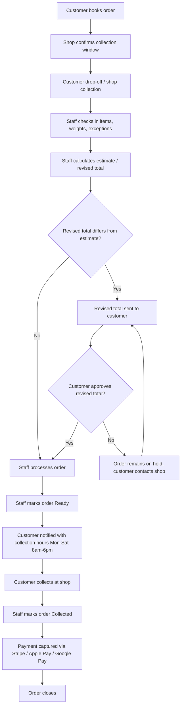
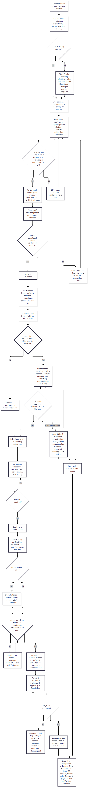
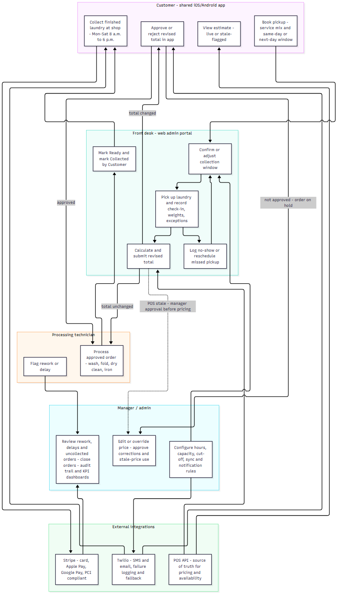
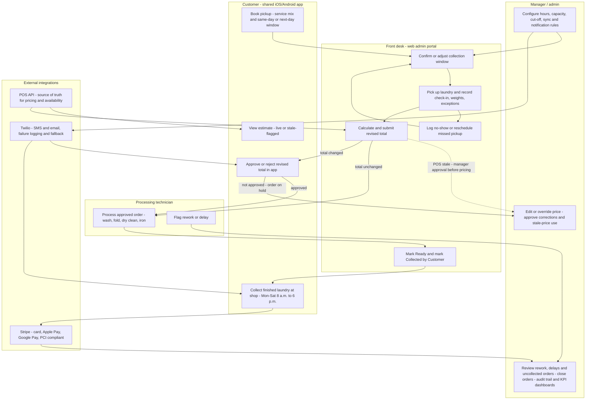
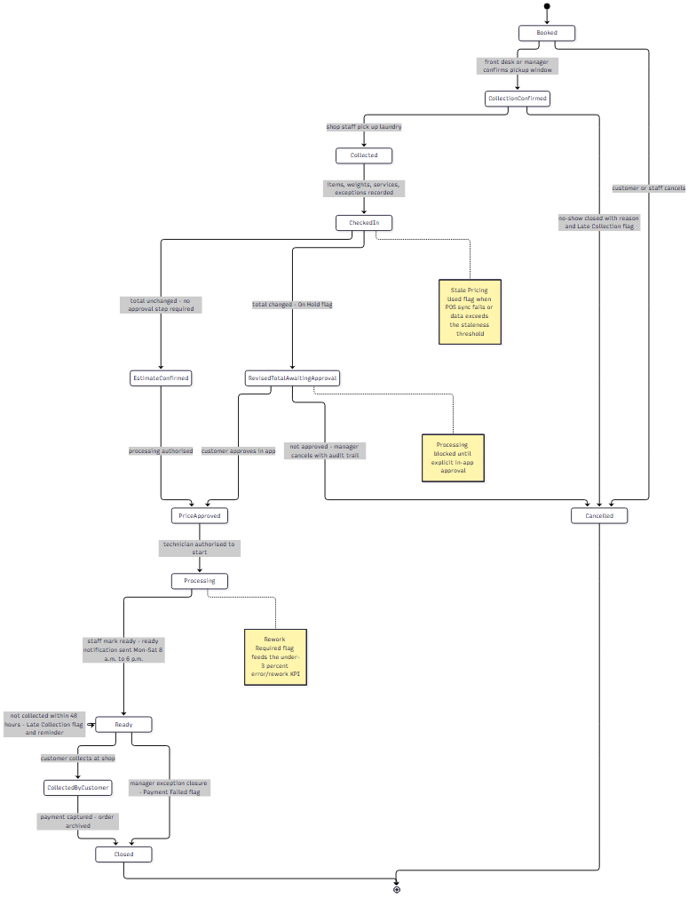
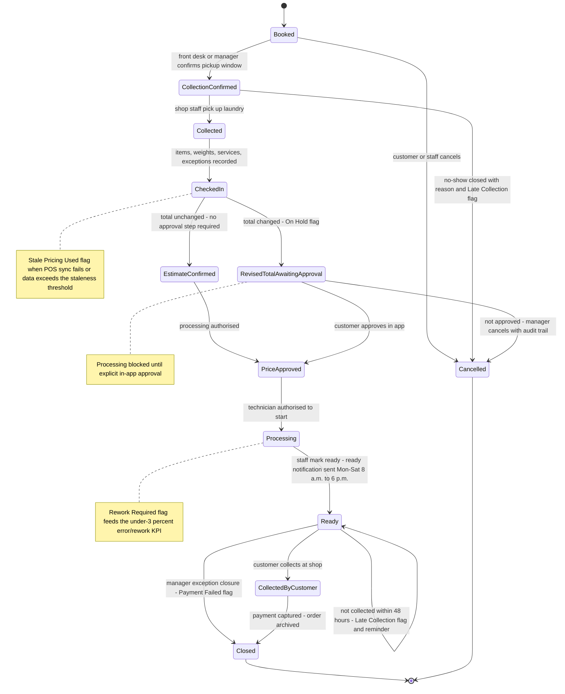
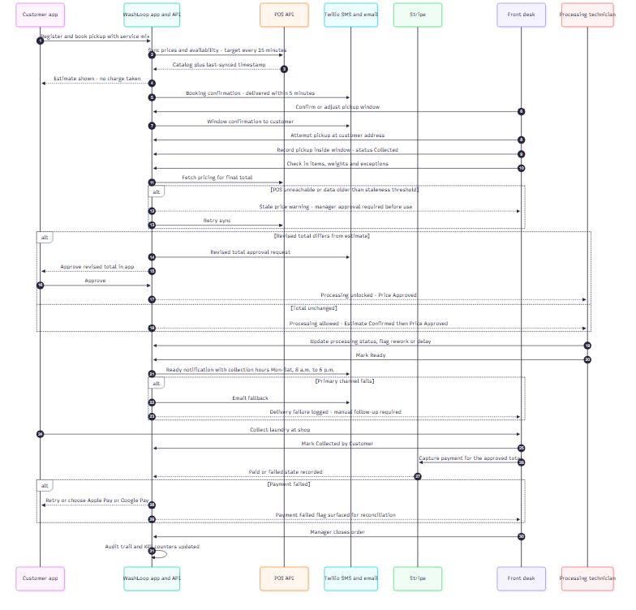
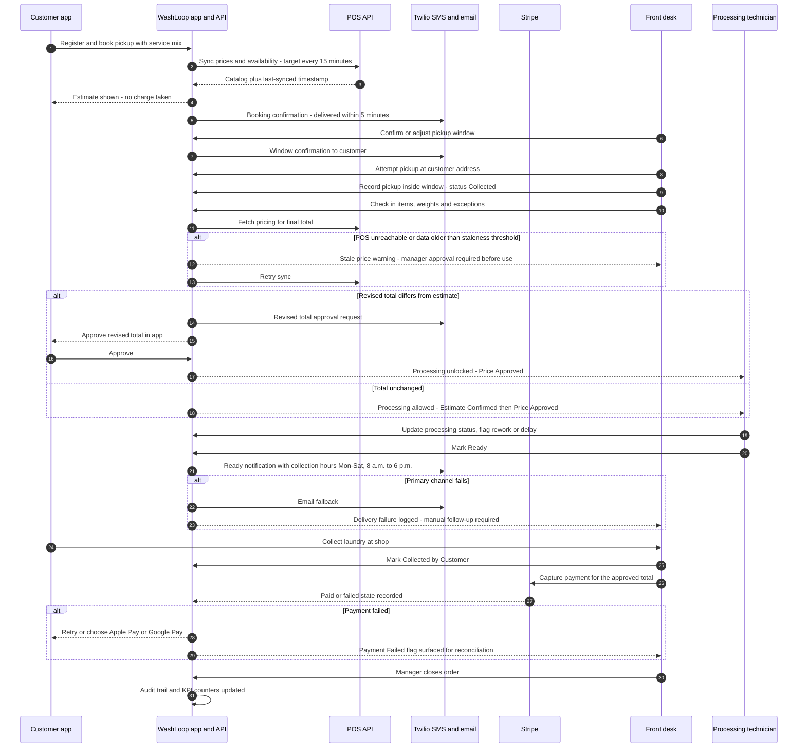

# Title Page

**Project:** WashLoop v1  
**Document:** Functional Specification Document  
**Version:** v1.0  
**Date:** 2026-08-14  
**Document Status:** Draft for review  
**Author:** Senior Business Analyst  
**Sponsor:** WashLoop Shop Owner  
**Related Area:** Customer mobile apps, shop operations, payment integration, notifications, and POS pricing integration  

---

## 1. Introduction

WashLoop is a laundry service shop application designed to help customers book laundry services and help shop staff manage the full order lifecycle from booking to collection. In v1, customers can book same-day or next-day collection, choose wash/fold, dry cleaning, ironing, or a mix of services, and pay through the app. The shop collects the laundry, checks in items, records weights and exceptions, calculates or revises the final price, processes the order, marks it ready for collection, and closes the order after the customer collects the laundry at the shop.

The objective of WashLoop v1 is to create a reliable, budget-friendly, single-location shop system that supports approximately 200 active customers per week and 30–40 orders per day. The system must include native iOS and Android customer apps using a shared codebase, a lightweight web admin portal for staff and managers, and integrations with Stripe, Apple Pay/Google Pay, Twilio SMS/email, and the shop’s POS API.

WashLoop v1 should improve operational visibility, reduce manual errors, provide customers with clear order status updates, ensure payment and customer data security, and enable staff to track orders through a standardized workflow. Home return delivery is explicitly out of scope for v1; customers collect completed laundry at the shop.

---

## 2. Scope

### 2.1 In Scope

WashLoop v1 includes the following capabilities:

- Customer registration and contact management.
- Laundry booking with same-day or next-day collection.
- Service selection for wash/fold, dry cleaning, ironing, and mixed services.
- Collection window confirmation and customer notification.
- Shop collection of customer laundry.
- Staff check-in of collected items, weights, quantities, and exceptions.
- Order status tracking across booking, collection, check-in, pricing approval, processing, readiness, collection, and closure.
- Final price estimate and revised-total approval workflow.
- Customer approval of revised price in the app before processing begins.
- Notification when an order is ready for shop collection.
- Display of shop collection hours when an order is ready: Monday to Saturday, 8 a.m. to 6 p.m.
- Payment through the app using Stripe card payments, Apple Pay, and Google Pay where supported.
- Twilio SMS and email notifications for key order events.
- POS API integration for pricing, service availability, and item/service data.
- Stale-price flagging when POS data is unavailable or outdated.
- Staff corrections with an audit trail.
- Admin portal for user management, service configuration, pricing sync, reporting, and KPI review.
- KPI dashboards and reporting for completed orders, on-time readiness, rework, cancellations, payment failures, notification failures, repeat customers, and ready-but-uncollected orders.

### 2.2 Out of Scope

The following are explicitly out of scope for WashLoop v1:

- Home return delivery.
- Multi-location shop support.
- Commercial or B2B bulk laundry services.
- Walk-in drop-off without a booked order.
- Subscriptions or recurring laundry plans.
- Loyalty programs or reward points.
- Post-collection re-wash, return handling, or complaint workflow.
- Complex warehouse or inventory management beyond POS pricing and availability.
- Advanced logistics route optimization beyond simple collection windows.

### 2.3 Platforms and Systems

The v1 solution includes:

- Native customer app for iOS.
- Native customer app for Android.
- Shared codebase for customer mobile apps to support budget and timeline.
- Lightweight web admin portal for shop staff and managers.
- POS API for pricing and service availability.
- Stripe for payment processing.
- Apple Pay and Google Pay integration where supported by the platform and payment provider.
- Twilio for SMS and email notifications.

### 2.4 Key Business Objectives

WashLoop v1 should deliver the following business outcomes:

- Clear end-to-end order lifecycle visibility.
- Reduced manual errors during check-in, pricing, and status updates.
- Improved customer communication through timely notifications.
- Faster staff workflow for collection, processing, and collection confirmation.
- Reliable payment and notification tracking.
- Accurate pricing sourced from the POS system.
- Measurable operational KPIs, including on-time readiness and order rework rate.

---
## 3. Functional Requirements

Requirements are numbered FR-001 through FR-060 and prioritized using MoSCoW: Must Have, Should Have, Could Have, Won’t Have.

### 3.1 Customer Account and Booking

| ID | Requirement | Priority |
|---|---|---|
| FR-001 | The system must allow customers to register with name, mobile number, email, and contact preferences. | Must Have |
| FR-002 | The system must allow customers to save and update contact details. | Must Have |
| FR-003 | The system must allow customers to create a laundry order. | Must Have |
| FR-004 | The system must allow customers to choose wash/fold, dry cleaning, ironing, or mixed services. | Must Have |
| FR-005 | The system must allow customers to select same-day or next-day collection. | Must Have |
| FR-006 | The system must display available collection windows based on shop operating hours and staff availability. | Must Have |
| FR-007 | The system must allow shop staff to confirm or adjust a customer’s collection window. | Must Have |
| FR-008 | The system must send a booking confirmation notification after an order is booked. | Must Have |
| FR-009 | The system must allow customers to cancel an order before collection. | Must Have |
| FR-010 | The system must allow customers to modify an order before collection, subject to shop rules. | Should Have |
| FR-011 | The system must prevent booking after the selected collection window has closed. | Must Have |
| FR-012 | The system must store booking date, collection window, selected services, and customer contact details on the order. | Must Have |

### 3.2 Order Lifecycle and Status Management

| ID | Requirement | Priority |
|---|---|---|
| FR-013 | Each order must have a unique order ID. | Must Have |
| FR-014 | The system must track order status using the v1 status flow: Booked, Collection Confirmed, Collected, Checked In, Estimate Confirmed, Revised Price Awaiting Approval, Price Approved, Processing, Ready, Collected, Closed, Cancelled. | Must Have |
| FR-015 | The system must maintain a status history for each order. | Must Have |
| FR-016 | Staff must be able to mark collection as completed. | Must Have |
| FR-017 | Staff must be able to record checked-in items, item counts, weights, service selections, and exceptions. | Must Have |
| FR-018 | Staff must be able to add staff notes to an order. | Must Have |
| FR-019 | Staff must be able to update processing status. | Must Have |
| FR-020 | Staff must be able to mark an order ready for customer collection. | Must Have |
| FR-021 | Staff must be able to mark an order collected by the customer. | Must Have |
| FR-022 | Staff must be able to close an order after collection. | Must Have |
| FR-023 | Admin or manager must be able to close an order with audit history. | Must Have |
| FR-024 | The system must prevent processing status changes before revised-total approval where a revised total is required. | Must Have |
| FR-025 | The system must allow staff to correct order details with an audit trail. | Must Have |
| FR-026 | The audit trail must record who made the change, what changed, when it changed, whether customer approval was required, and the resulting status. | Must Have |
| FR-027 | The system must show order history to the customer. | Must Have |
| FR-028 | The system must show receipts and payment status to the customer. | Must Have |

### 3.3 Pricing, POS Integration, and Revised Total Approval

| ID | Requirement | Priority |
|---|---|---|
| FR-029 | The POS API must be the source of truth for service pricing, available services, and available items. | Must Have |
| FR-030 | The system must sync POS pricing and availability near real time, with a minimum operational cadence of every 15 minutes. | Must Have |
| FR-031 | The system must display pricing to customers before booking. | Must Have |
| FR-032 | The system must store a price estimate on each order at booking. | Must Have |
| FR-033 | Staff must be able to calculate a final price after check-in based on items, weights, and services. | Must Have |
| FR-034 | If checked-in items, weights, or services change the estimate, the system must send the revised total to the customer in the app. | Must Have |
| FR-035 | If the revised total differs from the estimate, the order must remain on hold until the customer explicitly approves the revised total in the app. | Must Have |
| FR-036 | The system must display the revised amount and reason for the change, such as item count or weight adjustment. | Must Have |
| FR-037 | The system must not allow staff to move an order to Processing while it is in Revised Price Awaiting Approval. | Must Have |
| FR-038 | The system must provide a customer contact path for discussing the revised total or checked-in items. | Must Have |
| FR-039 | If POS pricing is unavailable or stale, the system must clearly flag prices as stale. | Must Have |
| FR-040 | The system must prevent silent use of stale pricing. | Must Have |
| FR-041 | Staff must see a visible warning when stale pricing is applied. | Must Have |
| FR-042 | Admin must be able to trigger a manual POS price sync. | Should Have |
| FR-043 | Admin must be able to configure service availability and pricing display rules. | Should Have |
| FR-044 | Admin must be able to approve price overrides with audit trail. | Should Have |

### 3.4 Payment Requirements

| ID | Requirement | Priority |
|---|---|---|
| FR-045 | The system must allow customers to pay through the app using Stripe card payments. | Must Have |
| FR-046 | The system must support Apple Pay and Google Pay where the platform and payment provider allow. | Must Have |
| FR-047 | The system must record payment state as unpaid, pending, paid, failed, refunded, or partially paid. | Must Have |
| FR-048 | The system must display payment failure states to the customer. | Must Have |
| FR-049 | The system must make payment failure states visible to staff and admin. | Must Have |
| FR-050 | The system must provide retry or contact instructions when payment fails. | Must Have |
| FR-051 | The system must generate a receipt after successful payment. | Must Have |
| FR-052 | The system must associate payment with the final approved order amount. | Must Have |

### 3.5 Notification Requirements

| ID | Requirement | Priority |
|---|---|---|
| FR-053 | The system must send Twilio SMS and/or email notifications for booking confirmation. | Must Have |
| FR-054 | The system must send notifications for collection confirmation. | Must Have |
| FR-055 | The system must send notifications when a revised total requires customer approval. | Must Have |
| FR-056 | The system must send notifications when an order is ready for shop collection. | Must Have |
| FR-057 | The system must send notifications for cancellation confirmation. | Must Have |
| FR-058 | Ready notifications must include shop collection hours: Monday to Saturday, 8 a.m. to 6 p.m. | Must Have |
| FR-059 | The system must log notification delivery failures. | Must Have |
| FR-060 | Staff and admin must be able to view notification failures and retry where possible. | Should Have |

---

## 4. Non-Functional Requirements

### 4.1 Availability and Reliability

| ID | Requirement | Target |
|---|---|---|
| NFR-001 | The customer app and admin portal should meet 99.5% uptime. | 99.5% availability |
| NFR-002 | Notifications triggered by status changes should be delivered within 5 minutes. | ≤ 5 minutes |
| NFR-003 | The system should remain usable during brief POS outages. | Degraded mode allowed |
| NFR-004 | POS outages must display clear stale-price warnings. | Visible warning required |
| NFR-005 | Core order workflows should not fail solely because POS pricing is unavailable. | Workaround with warning |
| NFR-006 | Notification failure states should be recorded and visible to staff/admin. | Required |

### 4.2 Security and Compliance

| ID | Requirement | Target |
|---|---|---|
| NFR-007 | Payment handling must follow PCI-compliant practices through Stripe. | PCI compliance via Stripe |
| NFR-008 | Customer personal and contact data must be stored securely. | Encrypted storage and access control |
| NFR-009 | Role-based access control is required for customer, staff, and admin access. | RBAC enforced |
| NFR-010 | Staff and admin actions that modify orders must be auditable. | Audit trail required |
| NFR-011 | Admin must be able to manage role permissions for staff accounts. | Required |
| NFR-012 | Payment token and card data should not be stored in WashLoop application databases; payment processing should remain within Stripe. | Required |

### 4.3 Performance and Capacity

| ID | Requirement | Target |
|---|---|---|
| NFR-013 | The system should support approximately 200 active customers per week. | Required |
| NFR-014 | The system should support approximately 30–40 orders per day. | Required |
| NFR-015 | POS price retrieval should be sufficiently fast for normal staff operations. | Near real-time or ≥15-minute sync |
| NFR-016 | Staff dashboards should refresh operational status without excessive delay. | Practical operational responsiveness |
| NFR-017 | The mobile app should provide responsive status updates for customers. | Required |

### 4.4 Usability

| ID | Requirement | Target |
|---|---|---|
| NFR-018 | The customer app should clearly show current order status. | Required |
| NFR-019 | Customers should be able to approve revised totals easily within the app. | Required |
| NFR-020 | Staff workflow should require minimal manual steps for check-in and status updates. | Required |
| NFR-021 | Admin portal should present daily KPIs and exception alerts in a simple dashboard. | Required |
| NFR-022 | The shared iOS/Android codebase must maintain a consistent customer experience. | Required |

### 4.5 Maintainability and Integration Lifecycle

| ID | Requirement | Target |
|---|---|---|
| NFR-023 | Stripe, Twilio, and POS credentials should use sandbox/test environments during development. | Required |
| NFR-024 | Production credentials should be configured before launch within the 12-week schedule. | Required |
| NFR-025 | Integration errors should be logged for troubleshooting. | Required |
| NFR-026 | The system should allow future v2 extensions without redesigning the core order model. | Recommended |

---
## 5. User Roles & Personas

WashLoop v1 supports three primary role groups: Customer, Staff, and Admin. Staff access may be further divided into front-desk, processing technician, and manager, using a default permission model that should be confirmed before build.

### 5.1 Customer Persona

**Persona:** Laundry customer at a single shop who wants convenient booking, clear pricing, and timely updates.

**Capabilities:**
- Register and save contact details.
- Book an order with same-day or next-day collection.
- Choose wash/fold, dry cleaning, ironing, or mixed services.
- View pricing before booking.
- Receive booking, collection, revised-price, ready, and cancellation notifications.
- View order status and status history.
- Approve revised total in the app before processing begins.
- Contact the shop to discuss revised pricing or checked-in items.
- Pay through the app using Stripe, Apple Pay, or Google Pay where supported.
- View receipts and order history.
- Cancel or modify bookings before collection, subject to shop rules.
- View collection hours when the order is ready.

**Permissions:**
- Customer access is limited to their own orders.
- Customers can approve revised totals and make payments.
- Customers cannot alter staff check-in details, POS pricing, or operational status.

### 5.2 Staff Persona

**Persona:** Shop staff member who manages bookings, collection, item check-in, processing updates, and customer collection.

**Capabilities:**
- View current bookings and collection windows.
- Confirm or adjust collection windows.
- Mark collection as completed.
- Record checked-in items, weights, quantities, services, and exceptions.
- Add staff notes.
- Update processing status.
- Mark order ready.
- Mark order collected.
- Correct order details with audit trail.
- View notification delivery failures for assigned orders.
- Contact customers when revised totals need discussion.

**Default Staff Permission Model**

| Staff Sub-role | Default Permissions |
|---|---|
| Front-desk staff | View bookings, confirm collection windows, mark collection completed, record check-in details, add notes, mark ready, mark collected |
| Processing technician | Update processing status, record service completion, flag exceptions, add notes |
| Manager/admin | Edit pricing assumptions, approve overrides, close orders, manage users, configure services, view reports and KPIs, manage audit trail |

**Note:** Explicit staff permission boundaries were not fully confirmed by the shop owner. The default model above should be reviewed and approved before implementation.

### 5.3 Admin Persona

**Persona:** Shop owner or operations manager responsible for configuration, reporting, and staff oversight.

**Capabilities:**
- Manage customer and staff accounts.
- Configure role-based permissions.
- Configure service availability.
- Trigger or monitor POS pricing sync.
- View operational reports and KPI dashboards.
- Monitor notification delivery failures.
- Review audit trails.
- Approve price overrides.
- Close orders.
- Manage shop collection hours display.

### 5.4 Role Summary Table

| Role | Primary Responsibility | Access Scope | Key Actions |
|---|---|---|---|
| Customer | Book laundry and collect at shop | Own orders only | Book, cancel, view status, approve revised total, pay |
| Staff | Operate order lifecycle | Assigned or all shop orders | Collect, check in, update status, mark ready, mark collected |
| Admin | Configure and monitor shop operations | Full operational view | Manage users, configure services, sync pricing, view reports |

---

## 6. Assumptions & Constraints

### 6.1 Assumptions

1. WashLoop v1 is for a single shop/location.
2. Customers collect laundry at the shop; no home return delivery is available.
3. The shop can use a shared iOS/Android codebase to meet budget and timeline.
4. The POS API provides current pricing, service availability, and item/service data.
5. Staff workflows are managed primarily through the lightweight web admin portal.
6. Customers have access to mobile devices capable of installing the iOS or Android customer app.
7. Shop collection hours are Monday to Saturday, 8 a.m. to 6 p.m.
8. The 12-week delivery schedule includes development, integration testing, UAT, and production cutover.
9. Stripe, Twilio, and POS API accounts are available and can be configured during development.
10. Staff role permissions may follow the default model unless the owner requests different restrictions.
11. Revised-total approval occurs in the app; phone or in-person approval alone is not sufficient for v1 unless the shop later changes the rule.

### 6.2 Constraints

1. Budget: $15,000–$18,000.
2. Timeline: 12 weeks.
3. Expected volume: approximately 200 active customers per week.
4. Expected order volume: approximately 30–40 orders per day.
5. v1 must remain lightweight to fit the budget and schedule.
6. Home return delivery must not be introduced in v1.
7. Multi-location operations must not be introduced in v1.
8. POS API availability affects pricing accuracy; stale prices must not be used silently.
9. Payment security must be handled through PCI-compliant Stripe processing rather than storing raw card data in WashLoop.
10. Notification delivery is dependent on Twilio service availability and valid customer contact details.
11. The system must support a shared mobile codebase rather than two fully separate native builds.

### 6.3 Dependencies

1. POS API access and documentation.
2. Stripe account and payment integration configuration.
3. Twilio account, SMS/email templates, and sender configuration.
4. Staff adoption of the admin portal for check-in and status updates.
5. Customer approval of revised totals before processing.
6. Availability of sandbox/test credentials before production cutover.
7. Reliable customer contact information for notifications.

### 6.4 Risks and Mitigations

| Risk | Impact | Mitigation |
|---|---|---|
| POS outage affects pricing | Incorrect or stale prices displayed | Flag stale prices clearly; require visible staff warning; allow degraded workflow only with warning |
| Customer delays revised-total approval | Orders remain on hold and readiness KPI declines | Send reminders; provide contact path; staff follow-up workflow |
| Notification delivery failure | Customer does not receive critical status update | Log failures; surface failures to staff/admin; retry where possible |
| Payment failure | Order cannot be finalized | Show failure state; provide retry or contact instructions |
| Scope creep | Budget or timeline exceeded | Keep v1 to core workflow and required integrations |
| Shared-codebase complexity | Integration or platform-specific issues | Use mature cross-platform framework and disciplined feature scope |
| Unclear staff permissions | Operational or audit risk | Define and approve role-based permissions before build |
| High uncollected orders | Operational congestion at shop | Daily dashboard showing ready orders not yet collected; collection reminders |

---
## 7. End-to-End Process Flow and Process Diagram

### 7.1 Process Flow Narrative

1. Customer books a laundry order and selects same-day or next-day collection.
2. Shop staff confirms the collection window and notifies the customer.
3. Customer drops laundry at the shop within the confirmed window.
4. Staff checks in items, recording counts, weights, services, and exceptions.
5. Staff calculates the price estimate / revised total using POS pricing.
6. If the revised total differs from the estimate, the customer must approve it in the app.
7. The order remains on hold until the customer approves the revised amount.
8. Staff processes the laundry: wash, fold, dry clean, iron, or mixed services.
9. Staff marks the order Ready.
10. Customer is notified that the order is ready, with collection hours Monday to Saturday, 8 a.m. to 6 p.m.
11. Customer collects laundry at the shop.
12. Staff marks the order Collected and takes payment via Stripe / Apple Pay / Google Pay.
13. Order closes and reporting metrics update.

### 7.2 Process Diagram

```text
Customer books
      |
      v
Shop confirms collection window
      |
      v
Shop collects / customer drop-off
      |
      v
Staff checks in items, weights, exceptions
      |
      v
Staff calculates price estimate / revised total
      |
      +--> Estimate unchanged -------------------> Staff processes order
      |
      +--> Estimate changed --> Revised total sent to customer
                                   |
                                   +--> Customer approves --> Staff processes order
                                   |
                                   +--> Customer does not approve --> Order stays ON HOLD
                                             (customer contacts shop to discuss)

      |
      v
Staff marks order Ready
      |
      v
Customer notified (Mon–Sat, 8 a.m.–6 p.m. collection hours)
      |
      v
Customer collects at shop
      |
      v
Staff marks order Collected
      |
      v
Order closes
```

### 7.3 Process Diagram (Mermaid)



### 7.4 Swimlane Summary

| Stage | Actor | System Action | Status |
|---|---|---|---|
| Booking | Customer | Order created, estimate shown | Booked |
| Confirmation | Front-desk staff | Window confirmed, notification sent | Collection Confirmed |
| Drop-off | Customer + front-desk staff | Arrival timestamp recorded | Collected |
| Check-in | Front-desk staff | Items, weights, exceptions captured | Checked In |
| Pricing | Front-desk staff + POS API | Estimate or revised total calculated | Estimate Confirmed / Revised Price Awaiting Approval |
| Approval | Customer | Explicit approval in app | Price Approved |
| Processing | Processing technician | Wash/fold/dry clean/iron performed | Processing |
| Readiness | Technician / front-desk | Ready notification with hours | Ready |
| Collection | Customer + front-desk staff | Items handed over, payment taken | Collected |
| Closure | Front-desk / manager | Order archived, KPIs updated | Closed |

---

## 8. Use Cases and User Stories

### UC-01: Customer Registration and Sign-in

**Actors:** Customer, Twilio notification service, Admin.

**Preconditions:** Customer has a supported iOS/Android device; Twilio is configured; RBAC and password policy are defined.

**Main flow:**
1. Customer opens the app and selects “Create account”.
2. Customer enters full name, email, mobile number, and password.
3. System validates email format, mobile number, password strength, and duplicate check.
4. Account is created and the `Customer` role is assigned.
5. Welcome SMS/email is sent via Twilio.
6. Customer signs in and sees bookings, order status, and shop information.

**Alternate/exception flows:**
- Duplicate email or mobile: customer prompted to sign in or reset password.
- Invalid email or phone: registration rejected with correction prompt.
- Twilio failure: account created but failure logged and visible to Admin.
- Password reset: reset link/code sent via SMS/email.

**Postconditions:** Account exists, customer role assigned, welcome notification attempted.

**Acceptance criteria:** Registration and sign-in work on the shared iOS/Android codebase; welcome notification attempted within 5 minutes; failures logged; password reset supported; authentication flow meets 99.5% uptime target.

### UC-02: Browse Services, Prices, and Availability

**Actors:** Customer, POS API, Admin.

**Main flow:** Customer opens the services page; app fetches service catalog and pricing from the POS API; app displays wash-and-fold, dry cleaning, ironing, and mixed services with prices; prices are marked as live if synced within 15 minutes.

**Alternate flows:** POS outage shows cached prices with a visible “prices not current — confirm at drop-off” warning; unavailable services are hidden or marked unavailable; malformed pricing is blocked and flagged to Admin.

**Acceptance criteria:** POS is the source of truth; sync at least every 15 minutes; stale prices are never used silently; shop collection hours are displayed.

### UC-03: Create a Same-Day or Next-Day Laundry Order

**Actors:** Customer, front-desk staff, Twilio.

**Main flow:** Customer selects service type, chooses same-day or next-day collection, selects a collection window within Mon–Sat 8 a.m.–6 p.m., provides estimated item count/weight and special instructions, system generates an estimate from POS pricing, checks capacity and cutoff rules, creates the order, and sends a booking confirmation via Twilio.

**Alternate flows:** No capacity in selected window — system offers alternatives; same-day cutoff exceeded — next-day offered; stale POS pricing — estimate shown with warning.

**Acceptance criteria:** Same-day and next-day booking supported; booking notification attempted within 5 minutes; capacity checks prevent overbooking; cutoffs configurable in admin portal; notification failures logged.

### UC-04: Confirm Collection Window and Notify Customer

**Actors:** Front-desk staff, customer, Twilio.

**Main flow:** Staff reviews the order queue, confirms or adjusts the window, marks the order Confirmed, and the system sends confirmation SMS/email; customer sees the confirmed window in the app.

**Acceptance criteria:** Order cannot progress without a confirmed window; notification within 5 minutes; staff action recorded with role, user, and timestamp; only front-desk staff or manager/admin may confirm windows.

### UC-05: Shop Collection / Customer Drop-off

**Actors:** Customer, front-desk staff.

**Main flow:** Customer arrives within the confirmed window; staff verifies identity and order reference; staff records arrival timestamp and marks order Collected; item check-in begins.

**Alternate flows:** Late arrival accepted only with manager approval and flagged as Late Arrival; customer does not arrive — order flagged No-show/Missed Collection.

**Acceptance criteria:** Arrival time recorded; late and missed collections tracked for KPIs; status moves to Collected when items are received.

### UC-06: Check-in Items, Weights, and Exceptions

**Actors:** Front-desk staff, processing technician, POS API.

**Main flow:** Staff records item categories and quantities, weights or weight bands, and exceptions (special care, damaged, non-standard, missing items, special requests); system retrieves POS pricing and calculates the estimate or revised total.

**Alternate flows:** Partial item list allowed with exception flag; POS unavailable — stale-price warning displayed and manager acknowledgement required where configured; exception requiring approval escalated to manager.

**Acceptance criteria:** Structured item/weight/exception capture; all check-in changes auditable; exception types configurable; stale pricing never used silently; technician sees approved item details before processing.

### UC-07: Revised Total Price Approval Workflow

**Actors:** Customer, front-desk staff, Twilio, manager/admin.

**Main flow:**
1. Staff prepares the revised total after check-in (example: estimate $25, revised total $32 for a 5 kg wash-and-fold).
2. System generates a revised-total approval request and sends Twilio SMS/email.
3. Customer sees original estimate, revised total, item breakdown, and exception notes in the app.
4. Customer taps “Approve revised total”.
5. Order status changes to Price Approved and processing may begin.

**Alternate flows:** Customer rejects the total — staff revises item list or service scope and re-sends; customer does not respond — order stays On Hold and staff contacts the customer; approval timeout triggers manager review; stale-price warning must be acknowledged before approval is presented.

**Postconditions:** Approval or rejection recorded with audit trail; order cannot move to Processing or payment without approval.

**Acceptance criteria:** Order held until explicit customer approval; clear estimate-versus-revised-total comparison; approval notification within 5 minutes; failure logged; workflow auditable (who, what, when, approval required, resulting status).

### UC-08: Processing Technician Status Updates

**Actors:** Processing technician, customer, Twilio, front-desk staff.

**Main flow:** Technician opens the approved order, reviews items and exceptions, marks Started, performs wash/fold/dry clean/iron steps, updates In Progress or Completed, and marks Ready; status notification is sent.

**Alternate flows:** Rework required — reason recorded and rework flag set; delay — status Delayed with reason; notification failure — logged and surfaced to admin.

**Acceptance criteria:** Status changes recorded with role, user, timestamp; notification attempted within 5 minutes; rework events aggregated for the <3% error/rework KPI; RBAC prevents unauthorized status changes.
### UC-09: Ready Notification and Shop Collection Hours

**Actors:** Processing technician, front-desk staff, customer, Twilio.

**Main flow:** Order is marked Ready; the system sends a Twilio SMS/email containing ready status, collection hours (Monday–Saturday, 8 a.m.–6 p.m.), shop location, payment options, and the approved total; the customer also sees the ready notification in the app.

**Alternate flows:** Customer does not pick up — order remains Ready and appears in the ready-but-uncollected report after a configured threshold; notification failure — staff resends manually; out-of-hours pickup request — staff restates shop hours.

**Acceptance criteria:** Ready notification includes collection hours; sent within 5 minutes of Ready status; failures logged; ready-but-uncollected orders reportable; on-time readiness measured against the ≥90% target.

### UC-10: Customer Pickup, Payment, and Order Completion

**Actors:** Customer, front-desk staff, Stripe / Apple Pay / Google Pay, Twilio.

**Main flow:** Customer arrives within collection hours; staff verifies order and identity; staff confirms the approved revised total; customer pays via Stripe card, Apple Pay, or Google Pay; on success the order status becomes Paid/Collected; laundry is handed over; payment confirmation sent; order archived.

**Alternate flows:** Payment declined — decline reason shown and customer retries; payment failure — order flagged Payment Failed and surfaced to staff/admin; final total not approved — order remains on hold and payment is not accepted; stale pricing discovered — reconcile with POS or manager-approved correction before accepting payment.

**Acceptance criteria:** Supported payment methods include Stripe card, Apple Pay, and Google Pay; PCI compliance handled through Stripe; success/failure logged and reportable; receipt notification attempted; order cannot be marked Paid without approved revised total; no silent stale-price payment acceptance.

### UC-11: Order Close and Archival

**Actors:** Front-desk staff, manager/admin.

**Main flow:** Staff confirms payment, collection, or cancellation is final; marks the order Closed; reporting metrics update; the order becomes read-only except through the correction workflow; archive remains available for reports.

**Acceptance criteria:** Closed orders cannot be modified outside the staff correction workflow; status history preserved in the audit trail; daily orders-by-status and ready-but-uncollected counts updated; RBAC controls who may close orders.

### UC-12: Cancellation and No-show Handling

**Actors:** Customer, front-desk staff, manager/admin, Twilio.

**Main flow:** Customer cancels in the app, or staff cancels for a shop reason; order status becomes Cancelled; cancellation notification sent; cancellation reason and initiating user logged; KPI reflects the cancellation.

**Alternate flows:** Cancellation after revised-total approval — cancellation recorded, approved amount retained for audit; no customer response after follow-up — staff cancels with reason; manager override — hold or cancel with audit entry.

**Acceptance criteria:** Cancellations notified via Twilio when contact details exist; failures logged; reason captured; staff cancellations require role authorization; audit trail records who, when, and resulting status.

### UC-13: Staff Corrections with Audit Trail

**Actors:** Front-desk staff, processing technician, manager/admin.

**Main flow:** Staff initiates a correction (wrong weight, missing item, incorrect service, incorrect revised total, status mistake); system checks role and correction type; approval-required corrections enter Awaiting Approval; manager approves or rejects; order updated; audit trail records actor, before/after values, timestamp, approval requirement, approver, and resulting status.

**Alternate flows:** Self-approval prohibited where configured; insufficient role — access denied; emergency admin override with reason and audit note; repeated corrections flagged for error/rework review.

**Acceptance criteria:** Every correction is auditable; trail includes who/what/when/approval-required/resulting status; manager can review correction history; error/rework rate reportable and targeted below 3%.

### UC-14: POS API Sync and Stale-Price Flagging

**Actors:** Admin/manager, front-desk staff, POS API integration.

**Main flow:** System fetches POS pricing and availability at the configured interval (target ≤15 minutes), updates the local catalog, and displays prices with a last-synced timestamp. On sync failure the system retains last-known prices and displays a stale-price warning.

**Alternate flows:** POS outage — degraded mode with flagged stale pricing and optional booking restriction; invalid price format — use blocked and error flagged; service unavailable — hidden or marked unavailable; sync timeout — alert logged and visible in admin reports.

**Acceptance criteria:** 15-minute sync target; stale flag visible to both customers and staff; no silent stale price used in estimates or payment acceptance; stale threshold and outage rules configurable; sync failures logged and reportable.

### UC-15: Admin Configuration of Users, Services, and Pricing

**Actors:** Manager/admin, front-desk staff, Twilio, POS API.

**Main flow:** Admin adds/deactivates staff accounts and assigns roles (front-desk, technician, manager), configures service availability and cutoffs, sets shop hours, configures POS sync interval and stale-price behaviour, manages Twilio notification templates, and sets KPI thresholds and report filters.

**Acceptance criteria:** RBAC enforced in the admin portal; configuration changes auditable; notification templates manageable; notification failure log and retry available; shop hours and capacity rules reflected in booking windows.

### UC-16: Notification Failure Logging and Recovery

**Actors:** Notification service (Twilio), front-desk staff, manager/admin.

**Main flow:** Each notification event (booking, collection confirmation, revised-total request, ready, cancellation, status update) is sent and logged as success, failure, provider error, or invalid recipient; failures are surfaced to staff/admin; retry is attempted where possible.

**Acceptance criteria:** All notification attempts logged with status and reason; failures visible in admin dashboard; retry supported; notification failure rate reportable; delivery target ≤5 minutes from status change.

### UC-17: Operational Reporting and KPI Dashboard

**Actors:** Manager/admin, front-desk staff.

**Main flow:** Daily dashboard displays orders by status, ready-but-uncollected orders, cancellations, payment failures, notification failures, on-time readiness, and error/rework rate; weekly report summarises on-time readiness, rework, and repeat customer rate.

**Acceptance criteria:** Daily operational view available; on-time readiness calculated against ≥90% target; error/rework rate calculated against <3% target; payment, cancellation, notification, and repeat-customer metrics reportable; reports exportable or printable for review.

### UC-18: Sandbox-to-Production Credential Cutover

**Actors:** Development team, manager/admin.

**Main flow:** Stripe, Twilio, and POS API credentials are configured in sandbox/test mode during development and integration testing; before launch within the 12-week schedule, credentials are switched to production and validated through smoke testing.

**Acceptance criteria:** Sandbox credentials used for all development and test transactions; production cutover completed and verified before go-live; integration errors logged during both phases.

---

## 9. User Stories by Role

### Customer

| ID | User Story | Acceptance Criteria |
|---|---|---|
| US-01 | As a customer, I want to register and save my contact details so I can book laundry services quickly. | Email/mobile required and validated; password reset supported; contact details editable. |
| US-02 | As a customer, I want to see available services and prices before booking so I know what I am buying. | POS-sourced prices displayed; stale prices clearly flagged; services listed. |
| US-03 | As a customer, I want to book same-day or next-day collection so I can choose a convenient drop-off time. | Same-day/next-day options; windows within Mon–Sat 8 a.m.–6 p.m.; cutoff rules enforced. |
| US-04 | As a customer, I want to receive notifications at each stage so I always know the status of my order. | Booking, collection, revised-price, ready, and cancellation notifications via SMS/email within 5 minutes. |
| US-05 | As a customer, I want to approve a revised total in the app before processing starts so there are no surprises. | Revised total shown with item breakdown and reason; order held until approval; contact option if I disagree. |
| US-06 | As a customer, I want to track my order status so I know when it will be ready. | Status history visible; current status always shown. |
| US-07 | As a customer, I want to pay in the app so I do not need to pay in person. | Stripe card, Apple Pay, Google Pay supported; failure states shown with retry guidance. |
| US-08 | As a customer, I want a receipt and order history so I can review my laundry spending. | Receipt generated after payment; history retained. |
| US-09 | As a customer, I want to cancel or modify my booking before collection so I can adjust plans. | Cancellation supported before collection; notification sent; audit logged. |
| US-10 | As a customer, I want to know the shop collection hours when my laundry is ready. | Ready notification includes Mon–Sat 8 a.m.–6 p.m. |

### Front-desk Staff

| ID | User Story | Acceptance Criteria |
|---|---|---|
| US-11 | As front-desk staff, I want to see today’s bookings and collection windows so I can prepare for drop-offs. | Queue view by window and status; capacity visible. |
| US-12 | As front-desk staff, I want to confirm collection windows and notify customers promptly. | Confirmation triggers Twilio notification within 5 minutes. |
| US-13 | As front-desk staff, I want to record items, weights, and exceptions at check-in so pricing is accurate. | Structured capture of categories, quantities, weights, exceptions. |
| US-14 | As front-desk staff, I want to send the revised total to the customer for approval so processing is authorised. | Order enters Revised Price Awaiting Approval; processing blocked until approval. |
| US-15 | As front-desk staff, I want to mark orders ready and collected so the shop workflow stays accurate. | Ready and Collected statuses available; notifications triggered. |
| US-16 | As front-desk staff, I want to correct order details with an audit trail so changes are traceable. | Correction captures actor, change, timestamp, approval requirement, resulting status. |

### Processing Technician

| ID | User Story | Acceptance Criteria |
|---|---|---|
| US-17 | As a technician, I want to see approved orders and their service details so I can process them correctly. | Approved orders visible with item list, exceptions, and notes. |
| US-18 | As a technician, I want to update processing status so customers are kept informed. | Started / In Progress / Ready statuses with timestamps. |
| US-19 | As a technician, I want to flag rework so error rates can be measured. | Rework reason captured and included in error/rework reporting. |

### Manager / Admin

| ID | User Story | Acceptance Criteria |
|---|---|---|
| US-20 | As a manager, I want a daily dashboard of orders by status so I can run the shop efficiently. | Daily view of statuses, ready-but-uncollected orders, cancellations, payment and notification failures. |
| US-21 | As a manager, I want on-time readiness and rework KPIs so I can monitor quality. | ≥90% on-time readiness target; <3% error/rework target. |
| US-22 | As an admin, I want to manage staff accounts and permissions so access is controlled. | RBAC for customer, staff, admin; role assignment and deactivation. |
| US-23 | As an admin, I want POS pricing and availability to stay in sync so prices are accurate. | ≥15-minute sync cadence; stale-price flagging; manual sync available. |
| US-24 | As an admin, I want notification failures visible so I can ensure customers are informed. | Failure log, retry option, failure-rate reporting. |

---
## 10. KPIs, Success Metrics, and Reporting Cadence

### 10.1 Core KPIs

| KPI | Definition | v1 Target |
|---|---|---|
| Completed orders | Orders reaching Collected/Closed status | Baseline captured from day 1 of go-live |
| On-time collection readiness | Percentage of orders marked Ready within the promised turnaround | **≥ 90%** |
| Order error / rework rate | Orders requiring correction, reprocessing, or manual follow-up | **< 3%** |
| Payment failure rate | Failed or abandoned payment attempts as a share of payment transactions | Monitored; alertable |
| Cancellation rate | Cancelled orders as a share of total bookings | Monitored; trend reviewed weekly |
| Repeat customer rate | Customers placing more than one order in the reporting period | Monitored |
| Orders by status | Daily snapshot of order counts in each lifecycle status | Daily |
| Ready-but-uncollected orders | Orders marked Ready and not yet collected after the configured threshold | Daily operational review |
| Notification delivery success | Percentage of Twilio notifications delivered successfully | Monitored; failures logged |

### 10.2 Reporting Cadence

**Daily operational dashboard**
- Orders by status
- Ready orders awaiting collection
- Cancellations and no-shows
- Payment failures
- Notification delivery failures
- POS sync health and stale-price incidents
- On-time readiness against target

**Weekly review**
- On-time readiness trend
- Error/rework trend
- Repeat customer performance
- Cancellation and payment failure trends
- Staff correction volume and approval turnaround

### 10.3 Dashboard Requirements

| ID | Requirement | Priority |
|---|---|---|
| KPI-001 | The admin portal must display a daily view of orders grouped by status. | Must Have |
| KPI-002 | The admin portal must list ready orders not yet collected. | Must Have |
| KPI-003 | On-time readiness must be calculated from confirmed collection window to Ready status. | Must Have |
| KPI-004 | Error/rework rate must be derived from recorded rework and correction events. | Must Have |
| KPI-005 | Payment and notification failure counts must be visible to admin. | Must Have |
| KPI-006 | KPI thresholds (90% readiness, 3% rework) must be configurable. | Should Have |
| KPI-007 | Reports must be exportable or printable for weekly review. | Could Have |

---

## 11. Integrations and External Systems

### 11.1 Stripe

- Purpose: card payment processing for customer payments in the app.
- Behaviour: PCI-compliant handling; WashLoop does not store raw card data.
- Required states: unpaid, pending, authorised, paid, failed, refunded, partially paid.
- Failure handling: failure reason surfaced to the customer and visible to staff/admin; retry or contact-shop guidance provided.
- Credential lifecycle: sandbox keys during development and integration testing; production keys before launch within the 12-week schedule.

### 11.2 Apple Pay / Google Pay

- Purpose: digital wallet payment options within the native iOS and Android customer apps.
- Behaviour: supported where the platform and Stripe configuration allow.
- Requirement: wallet payments map to the approved final order amount and produce the same payment state tracking as card payments.

### 11.3 Twilio (SMS and Email)

- Purpose: customer and staff notifications across the order lifecycle.
- Notification events:
  1. Booking confirmation
  2. Collection window confirmation
  3. Revised-total approval request
  4. Order ready notification (includes shop collection hours Mon–Sat, 8 a.m.–6 p.m.)
  5. Cancellation confirmation
  6. Optional collection reminder
- Requirement: notification delivery target of ≤5 minutes from the triggering status change.
- Requirement: all delivery attempts logged with success/failure status and reason; failures visible to staff/admin with retry capability.
- Credential lifecycle: sandbox/test Twilio account during development; production credentials before go-live.

### 11.4 POS API

- Purpose: source of truth for service pricing, service availability, and item/service catalog data.
- Sync behaviour: near real-time with a minimum operational cadence of every 15 minutes.
- Outage behaviour:
  - Application remains usable.
  - Last-known prices retained but flagged as stale.
  - Silent use of stale prices prohibited.
  - Staff and customers see a visible warning with a last-synced timestamp.
  - Manager/admin acknowledgement required where configured before a stale-price estimate is presented for approval.
- Requirement: sync health, failures, and stale-price incidents are logged and reportable.
- Credential lifecycle: sandbox/test POS credentials during development; production credentials cut over before launch.

### 11.5 Integration Summary

| Integration | Purpose | Key Behaviour | Priority |
|---|---|---|---|
| Stripe | Card payments | PCI-compliant processing; failure states surfaced | Must Have |
| Apple Pay / Google Pay | Mobile wallet payments | Supported where platform and provider allow | Must Have |
| Twilio | SMS and email notifications | ≤5-minute delivery; failure logging and retry | Must Have |
| POS API | Pricing and availability | ≥15-minute sync; stale-price flagging on outage | Must Have |
| Web admin portal | Staff and admin operations | RBAC, audit trail, dashboards | Must Have |

---

## 12. Acceptance Criteria Summary

The WashLoop v1 build is considered complete when the following are demonstrated:

1. A customer can register, book a same-day or next-day collection, and receive a booking confirmation notification.
2. Shop staff can confirm a collection window and record the drop-off.
3. Staff can record checked-in items, weights, and exceptions, and the system calculates an estimate or revised total from POS pricing.
4. When the revised total differs from the estimate, the customer receives an approval request and the order remains on hold until approval is recorded in the app.
5. Staff cannot move an order to Processing while it is awaiting revised-total approval.
6. When an order is marked Ready, the customer receives a notification including collection hours Mon–Sat, 8 a.m.–6 p.m.
7. Staff can mark an order Collected and close it.
8. Customers can pay using Stripe card, Apple Pay, and Google Pay where supported, with failure states surfaced.
9. POS sync runs at least every 15 minutes; stale prices are visibly flagged and never used silently.
10. All notification attempts are logged; failures are visible to staff and admin.
11. Every staff correction produces an audit trail entry (who, what, when, approval required, resulting status).
12. RBAC is enforced for customer, front-desk staff, processing technician, and manager/admin roles.
13. The admin dashboard shows orders by status, ready-but-uncollected orders, on-time readiness, rework rate, cancellations, payment failures, and notification failures.
14. Sandbox-to-production credential cutover for Stripe, Twilio, and the POS API is completed and validated before launch.
15. Uptime ≥99.5% and notification delivery ≤5 minutes are demonstrated during UAT.

---
## 13. Glossary

| Term | Definition |
|---|---|
| Order | A customer's laundry service request in WashLoop, containing items, selected services, pricing, payment status, collection arrangements, and lifecycle status. The owner's term for one customer booking. |
| Booking | A customer-created reservation for laundry service that becomes an Order. |
| Collection window | The agreed time interval during which the shop collects, or the customer drops off, laundry items. |
| Same-day / next-day collection | Service commitment that an order is processed and ready for collection within the same day or the next business day. |
| Drop-off | Physical delivery of laundry items to the WashLoop shop by the customer. |
| Check-in | Front-desk process of recording received items, quantities, weights, condition, and service details before processing begins. |
| Item / weight band | A pricing or processing category based on item type, quantity, or measured weight. |
| Exception | Any issue affecting normal processing, such as damaged items, missing items, unsuitable fabrics, incorrect weights, or special customer requests. |
| Estimate | The preliminary price shown before item verification, exceptions, or revised totals. |
| Revised total | The updated final order price after check-in reveals changed items, weights, services, or exceptions. |
| Price approval / on-hold state | Lifecycle state in which the order cannot proceed to Processing until the customer approves the revised total in the app. |
| Ready | Order status indicating processing is complete and items are available for customer collection at the shop. |
| Collected | Status confirming the customer physically picked up the order at the shop. |
| Closed order | An order no longer active, typically after collection, cancellation, or administrative closure. |
| Order status history | The chronological sequence of order states from Booked through Collected and Closed, with timestamps and actors. |
| Audit trail | A record of who performed an action on an order, when, what changed, whether approval was required, and the resulting status. |
| Stale price | Pricing data flagged as outdated or unavailable because the POS sync failed or exceeded the staleness threshold. |
| POS API | The shop's point-of-sale interface used as the source of truth for pricing and service/item availability. |
| Service catalog | The configured set of services, prices, rules, and availability constraints in WashLoop. |
| Wash-and-fold | Standard laundry washing, drying, and folding service. |
| Dry cleaning | Specialty cleaning service for items not suitable for normal washing. |
| Ironing | Pressing or steaming service applied after cleaning. |
| Mixed service | An order containing more than one service type, for example wash-and-fold plus dry cleaning. |
| RBAC (role-based access control) | Permission model restricting system access and actions based on assigned user role. |
| Front-desk staff | Shop users responsible for customer contact, collection confirmation, check-in, exceptions, payment confirmation, and collection validation. |
| Processing technician | Staff responsible for washing, drying, dry cleaning, ironing, folding, and recording processing progress. |
| Manager / admin | Role responsible for approvals, overrides, catalog configuration, KPI review, user management, and operational control. |
| Stripe | Payment gateway provider used for card and wallet payment processing. |
| Payment state | Current payment status of an order: unpaid, pending, authorised, paid, failed, refunded, or partially paid. |
| Apple Pay / Google Pay | Digital wallet payment methods supported through the payment provider on iOS and Android respectively. |
| PCI compliance | Security standards governing secure storage, transmission, and processing of payment card data. |
| Twilio SMS/email notification | Messaging service used to send customer and staff notifications about order events. |
| Notification delivery failure | An event where a notification is not successfully delivered due to invalid contact details, provider issues, or network errors. |
| KPI | Key Performance Indicator: a measurable metric used to evaluate WashLoop operational performance. |
| On-time readiness | Percentage of orders marked Ready within the promised turnaround; v1 target ≥90%. |
| Error / rework rate | Frequency of orders requiring correction, reprocessing, or manual follow-up; v1 target <3%. |
| Repeat customer rate | Percentage of customers placing more than one order within a defined reporting period. |
| Ready-but-uncollected order | An order marked Ready but not collected within the expected window, reported daily for shop follow-up. |
| Sandbox vs production credentials | Separate API keys and access tokens for test environments versus live environments. |
| Shared codebase | A single source codebase used to deliver both the iOS and Android customer apps within budget and timeline. |
| UAT | User Acceptance Testing: validation by intended users that the solution meets business requirements before go-live. |
| Production cutover | Controlled transition from sandbox/test configuration to live production credentials and services. |
| Acceptance criteria | Conditions that must be satisfied for a requirement or feature to be considered complete. |
| MoSCoW prioritisation | Requirement prioritisation model using Must, Should, Could, and Won't categories. |
| Out of scope | Features and requirements excluded from WashLoop v1, including home return delivery, loyalty, subscriptions, multi-location, and B2B services. |

---

## 14. Open Items Requiring Confirmation

The following items were not explicitly confirmed by the shop owner during requirements gathering and are recorded here as assumptions to be validated before development starts:

1. **Staff permission boundaries.** The default model assumes front-desk staff can record check-in and mark ready/collected, technicians update processing status only, and managers/admins edit pricing assumptions, approve overrides, and close orders. Confirmation required.
2. **POS sync staleness threshold.** A 15-minute sync cadence is assumed; the exact age at which a price is considered "stale" and whether booking is blocked at that point needs owner confirmation.
3. **Payment timing.** Whether payment is captured at booking, after revised-total approval, or at shop collection is not fully confirmed; the spec assumes payment is captured before order closure and cannot be accepted before revised-total approval.
4. **Cancellation and modification rules.** Cutoff times, refunds, and fees for cancellations are not defined for v1.
5. **On-time readiness definition.** The spec assumes measurement from confirmed collection window/drop-off to Ready status; the exact SLA hours per service type need confirmation.
6. **Out-of-scope list.** Home delivery, multi-location, B2B, walk-in drop-off without booking, subscriptions, loyalty, and post-collection re-wash/returns are assumed out of scope for v1.

---

**Document Status:** Draft for review by WashLoop shop owner and development team.
# Revision 1.1 — Gap Closure and Reconciliation

The sections below resolve the gaps, contradictions, and unconfirmed assumptions identified during the specification review. They supersede conflicting statements earlier in this document.

---

## 15. Document Information

### 15.1 Document Approvers & Reviewers

| Name | Role | Approver / Reviewer | Approval / Review Date | Approved / Review Version |
|---|---|---|---|---|
| Senior Business Analyst | Author | Author | 2026-08-14 | v1.0 draft |
| WashLoop Shop Owner | Sponsor / Product Owner | Approver | TBD | v1.1 |
| Shop Manager | Operational Reviewer | Reviewer | TBD | v1.1 |
| Lead Developer / Solution Architect | Technical Reviewer | Reviewer | TBD | v1.1 |
| Head of UAT | UAT Approver | Approver | TBD | v1.1 |
| POS Vendor Representative | Integration Reviewer | Reviewer | TBD | v1.1 |

**Action required:** sponsor must supply approver names and review dates before the document is baselined.

### 15.2 Document History

| Version | Date | Author | Change Summary |
|---|---|---|---|
| v1.0 | 2026-08-14 | Senior Business Analyst | Initial functional specification drafted from consolidated requirements brief. |
| v1.1 | 2026-08-14 | Senior Business Analyst | Gap closure: document governance, canonical status model, collection-model reconciliation, RBAC matrix, Won't-Have scope cut, expanded non-functional requirements, KPI formulas, eight additional use cases. |

### 15.3 Reference Documents

1. WashLoop v1 Consolidated Requirements Brief (summarizer_agent output).
2. Interview Q&A log (interviewer_agent): scope, roles, KPIs, non-functional defaults, integrations.
3. POS API technical documentation (vendor-supplied; endpoints, rate limits, authentication).
4. Stripe API and PCI compliance documentation.
5. Twilio SMS and email messaging documentation.
6. Corporate Functional Requirements Specification template (BS-[number] format).
7. Original project brief from the shop owner.

### 15.4 Definitions, Acronyms and Abbreviations

See Section 13 (Glossary). Acronyms in use: RBAC, KPI, SLA, UAT, PCI, POS, SMS, RTO, RPO, MoSCoW, FSD.

---

## 16. Reconciliation of Contradictions

### 16.1 Collection Model — Pickup, not drop-off (resolved)

The requirements brief and Section 2.1 state that **the shop collects laundry from the customer** within a same-day or next-day confirmed window. The process diagrams in Section 7 and UC-05 incorrectly referred to "customer drop-off".

**Corrected v1 rule:**

| Concept | Correct v1 definition |
|---|---|
| Collection window | The agreed time slot during which **shop staff collect laundry from the customer's address**. |
| Collection confirmation | Staff confirms or adjusts the window and notifies the customer. |
| Collected | Staff physically pick up the laundry and record the collection timestamp. |
| Shop collection hours (Mon–Sat, 8 a.m.–6 p.m.) | The hours during which the customer may **collect the finished laundry at the shop** after the order is Ready. |
| Walk-in drop-off without a booking | Out of scope for v1 (see UC-23 for the counter boundary rule). |

All references to "customer drop-off" in Sections 7.1–7.4 and UC-05 should be read as "shop pickup from customer". Section 17 (Revised Process Flow) restates the corrected flow.

### 16.2 Canonical Order Status Model (replaces FR-014 list)

The canonical status set is below. Statuses such as "Delayed", "No-show", "Paid" and "Awaiting Approval" that appeared in individual use cases are now modelled as **flags**, not statuses, so the lifecycle remains single-path and auditable.

**Statuses (mutually exclusive, sequential)**

| # | Status | Meaning |
|---|---|---|
| 1 | Booked | Order created with services and intended collection window. |
| 2 | Collection Confirmed | Shop confirmed the pickup window. |
| 3 | Collected | Shop staff picked up the laundry. |
| 4 | Checked In | Items, weights, services and exceptions recorded. |
| 5 | Revised Total Awaiting Approval | Revised total sent; customer approval outstanding. |
| 6 | Price Approved | Customer explicitly approved the revised total in the app. |
| 7 | Processing | Work in progress on wash/fold/dry-clean/iron. |
| 8 | Ready | Completed laundry available for customer collection. |
| 9 | Collected by Customer | Customer picked up the finished laundry. |
| 10 | Closed | Final administrative closure; order archived. |
| 11 | Cancelled | Order cancelled by customer or staff. |
| 12 | Collection Missed | Customer did not make the confirmed pickup available / no-show. |

**Flags (can coexist with a status)**

| Flag | Meaning |
|---|---|
| On Hold | Order cannot advance until approval or clarification is completed. |
| Payment Failed | A payment attempt failed or payment is outstanding. |
| Rework Required | Processing needs correction; counts toward error/rework KPI. |
| Late Collection | Pickup occurred outside the confirmed window. |
| Stale Pricing Used | Last-known POS price used while POS sync failed. |
| Approval Pending (correction) | Staff correction requires manager approval before applying. |

### 16.3 Payment Model (default rule, requires owner confirmation)

**Default v1 rule adopted for the specification:**

1. At booking, the app shows an **estimate only**; no charge is taken.
2. After check-in, if the total changes, the customer must **approve the revised total in the app**.
3. Payment is captured **after Price Approved**, either in-app before collection or at the counter during collection via Stripe card / Apple Pay / Google Pay.
4. An order cannot be marked **Collected by Customer → Closed** unless the payment state is `Paid`, or unless a Manager/Admin records an explicit unpaid-closure exception with audit trail.
5. Refunds/chargebacks are handled through Stripe and surfaced in reconciliation reporting.

**Confirmation required from owner:** whether a deposit at booking is desired, whether prepayment before pickup is mandatory, and the refund/chargeback policy.

### 16.4 MoSCoW — "Won't Have" Scope Cut (explicit)

| ID | Requirement | Priority |
|---|---|---|
| W-001 | Home return delivery of finished laundry. | Won't Have |
| W-002 | Multi-location shop support or location switching. | Won't Have |
| W-003 | Commercial / B2B bulk laundry contracts. | Won't Have |
| W-004 | Unbooked walk-in drop-off as a system-supported order type. | Won't Have |
| W-005 | Subscriptions or recurring laundry plans. | Won't Have |
| W-006 | Loyalty points, rewards, or referral schemes. | Won't Have |
| W-007 | Post-collection re-wash, complaint or return workflow. | Won't Have |
| W-008 | Route optimisation / driver scheduling beyond simple time windows. | Won't Have |
| W-009 | In-app chat or messaging with staff. | Won't Have |
| W-010 | Real-time photo/video item capture during check-in. | Won't Have |

### 16.5 Capacity and Availability Rules (previously undefined)

| ID | Requirement | Priority |
|---|---|---|
| FR-061 | Admin must be able to set a maximum number of pickups per collection window (default 10 orders per hour). | Must Have |
| FR-062 | Admin must be able to set a same-day booking cut-off time (default 2:00 p.m.). | Must Have |
| FR-063 | Orders booked after the same-day cut-off must automatically default to next-day collection. | Must Have |
| FR-064 | The app must show only windows with remaining capacity. | Must Have |
| FR-065 | Staff must be able to temporarily close a window (e.g. staff absence) and affected customers must be notified. | Must Have |
| FR-066 | Shop operating hours (Mon–Sat, 8 a.m.–6 p.m.) must be configurable in the admin portal and used for both pickup windows and collection availability. | Must Have |

---

## 17. RBAC Matrix (Action × Role)

Access is role-based in both the mobile app and the web admin portal. All staff roles share the same lightweight web admin portal with role-restricted views. **Values below are the recommended v1 defaults and require owner sign-off.**

| Action | Customer | Front-desk Staff | Processing Technician | Manager / Admin |
|---|---|---|---|---|
| Register / update own profile | Yes | Yes | Yes | Yes |
| View own orders | Yes | No | No | Yes (all) |
| Create / cancel own order | Yes | No | No | Yes |
| Confirm or adjust collection window | No | Yes | No | Yes |
| Mark order Collected (pickup done) | No | Yes | No | Yes |
| Record check-in items, weights, exceptions | No | Yes | No | Yes |
| Calculate / submit revised total | No | Yes | No | Yes |
| Edit or override a price | No | No | No | Yes |
| Approve a price override | No | No | No | Yes |
| Approve staff correction | No | No | No | Yes |
| Move order to Processing | No | No | Yes | Yes |
| Update processing status / flag rework | No | No | Yes | Yes |
| Mark order Ready | No | Yes | Yes | Yes |
| Mark order Collected by Customer | No | Yes | No | Yes |
| Close an order | No | No | No | Yes |
| Cancel an order | Own orders | Yes | No | Yes |
| Configure services, hours, capacity | No | No | No | Yes |
| Trigger POS sync / view sync health | No | View | No | Yes |
| View notification failure log | Own order | Assigned orders | Assigned orders | Yes (all) |
| View KPI dashboards | No | Limited (own queue) | Limited (own queue) | Yes (full) |
| View audit trail | Own order history | Assigned orders | Assigned orders | Yes (all) |
| Self-approval of own correction | N/A | Not permitted | Not permitted | Permitted but logged |

---

## 18. Revised Process Flow (corrected)

```text
Customer books pickup (estimate shown, no charge)
      |
      v
Shop confirms pickup window  ->  customer notified
      |
      v
Shop collects laundry at customer address  ->  Collected
      |
      v
Staff checks in items, weights, exceptions  ->  Checked In
      |
      v
Staff calculates estimate / revised total from POS pricing
      |
      +--> total unchanged --> Price Approved --> Staff processes
      |
      +--> total changed --> Revised total sent to customer
                                 |
                                 +--> Customer approves --> Staff processes
                                 |
                                 +--> Customer rejects/ignores --> ON HOLD
                                        (customer contacts shop; manager may
                                         rescope, adjust, or cancel)
      |
      v
Staff marks Ready  ->  customer notified (collect at shop Mon-Sat 8am-6pm)
      |
      v
Customer collects at shop -> payment captured (Stripe / Apple Pay / Google Pay)
      |
      v
Staff marks Collected by Customer -> Order Closed -> KPIs updated
```

---

## 19. Expanded Non-Functional Requirements

### 19.1 Performance and Capacity

| ID | Requirement | Target |
|---|---|---|
| NFR-027 | API response time for order read/write operations | ≤ 2 s (95th percentile) |
| NFR-028 | Mobile app first-content render on supported devices | ≤ 3 s |
| NFR-029 | Admin dashboard refresh after a status change | ≤ 10 s |
| NFR-030 | POS price fetch and local catalog update | ≤ 5 s per sync cycle |
| NFR-031 | Concurrent load | 200 active customers/week, 30–40 orders/day, with headroom to 2× peak (80 orders/day) |
| NFR-032 | Notification queue processing | No event delayed beyond 5 minutes under normal load |

### 19.2 Security, Privacy and Data Governance

| ID | Requirement | Target |
|---|---|---|
| NFR-033 | Data in transit encrypted using TLS 1.2 or higher | Required |
| NFR-034 | Customer contact data encrypted at rest | Required |
| NFR-035 | Raw card data never stored in WashLoop; only Stripe token/transaction references | Required |
| NFR-036 | Password policy: minimum 8 characters, hashed with a modern algorithm, rate-limited login attempts | Required |
| NFR-037 | Session expiry and token refresh for staff/admin sessions | Required |
| NFR-038 | Retention: order and audit records retained 24 months; notification logs 12 months | Recommended |
| NFR-039 | Customer may request deletion of personal data under applicable privacy law | Required |
| NFR-040 | Security incident response: suspected breach reported to owner within 24 hours | Required |
| NFR-041 | Least-privilege access; staff accounts disabled on role change or termination | Required |

### 19.3 Availability, Backup and Disaster Recovery

| ID | Requirement | Target |
|---|---|---|
| NFR-042 | Uptime 99.5% measured monthly, excluding scheduled maintenance | Required |
| NFR-043 | Scheduled maintenance window announced ≥48 hours in advance | Required |
| NFR-044 | Automated daily database backup | Required |
| NFR-045 | Recovery Time Objective (RTO) | ≤ 4 hours |
| NFR-046 | Recovery Point Objective (RPO) | ≤ 24 hours of data |
| NFR-047 | Graceful degradation when Stripe, Twilio or POS is unavailable | Required |

### 19.4 Compatibility and Accessibility

| ID | Requirement | Target |
|---|---|---|
| NFR-048 | iOS app supports iOS 13 and above | Required |
| NFR-049 | Android app supports Android 9 and above | Required |
| NFR-050 | Admin portal works on current Chrome, Safari, Edge and Firefox | Required |
| NFR-051 | App supports screen readers, adjustable text size and sufficient colour contrast | Recommended |
| NFR-052 | Shared codebase delivers feature parity across iOS and Android for all Must-Have requirements | Required |

### 19.5 Support, Maintenance and Operations

| ID | Requirement | Target |
|---|---|---|
| NFR-053 | Defect reporting and triage through a tracked ticket system | Required |
| NFR-054 | Critical (shop-down) defects responded to within 4 business hours | Required |
| NFR-055 | Minor defects fixed in the next scheduled release | Required |
| NFR-056 | Release cadence: at least one release every 2 weeks during the 12-week build, then monthly | Recommended |
| NFR-057 | Named owner responsible for Stripe, Twilio and POS credentials after go-live | Required (owner to name) |
| NFR-058 | Staff training and short operational guide for the admin portal | Required |
| NFR-059 | Change requests logged, assessed against budget, and approved by owner before implementation | Required |

### 19.6 How Uptime Is Measured

- Uptime is measured from monitoring of the API and admin portal.
- Planned maintenance announced in advance is excluded from the 99.5% calculation.
- Third-party outages (Stripe, Twilio, POS vendor) are reported separately as dependency incidents, not as WashLoop downtime, provided graceful degradation is functioning.
## 20. Additional Use Cases (Gap Closure)

### UC-19: Rescheduling a Missed or Late Collection

**Actors:** Customer, front-desk staff, manager/admin, notification service.

**Preconditions:** Order is in `Collection Confirmed`; a pickup window exists; shop capacity rules configured; customer contact details available.

**Main flow:**
1. System detects the pickup did not occur within the confirmed window.
2. Staff records the order as `Collection Missed` or applies the `Late Collection` flag.
3. Staff checks whether a same-day reschedule is possible; if not, offers the next available day.
4. Customer is notified in the app and by SMS/email.
5. Customer requests a new window in the app, or staff proposes one.
6. Staff confirms the new window; order status returns to `Collection Confirmed`.
7. Original window, new window, reason and responsible staff member are logged.
8. KPI reporting captures the no-show, late collection and reschedule outcome.

**Alternate/exception flows:**
- Customer unavailable slightly outside the window: staff accepts with `Late Collection` flag if policy allows.
- No same-day capacity: system offers next-day window; customer accepts or requests a later date.
- No customer response: order held for a configurable period, then marked `Collection Missed`.
- Manager override: manual reschedule or cancellation with audit trail.
- Notification failure: logged; staff contacts customer manually.

**Acceptance criteria:** No-shows and late collections are recorded; rescheduling respects capacity and cut-off rules; customer notified; reschedule events auditable; KPI dashboards show missed, late and rescheduled collections.

### UC-20: Updating Contact Details Used for Notifications

**Actors:** Customer, front-desk staff, notification service.

**Main flow:** Customer opens account settings, updates mobile number, email, or notification channel preference; the system validates formats and checks for duplicates; a verification SMS or email is sent; future notifications use the verified details; the change is logged in the audit trail.

**Alternate flows:** Verification SMS fails → retry then email fallback; both fail → notifications restricted until verification succeeds; staff-assisted updates allowed only where RBAC permits and are logged.

**Acceptance criteria:** Customers can change SMS and email details and set a channel preference; changes are validated and, where required, verified; failures logged; RBAC prevents unauthorised contact changes.

### UC-21: Price Dispute and Escalation After a Revised Total

**Actors:** Customer, front-desk staff, manager/admin, notification service.

**Main flow:**
1. Customer rejects the revised total in the app or contacts the shop.
2. Staff records the concern (item count, weight, exception fee, service misunderstanding, stale-price concern).
3. Staff reviews the item breakdown and notes; if clarification resolves it, the revised total is corrected and re-sent.
4. If unresolved, staff escalates to manager/admin.
5. Manager reviews order, audit trail, POS pricing and notes and selects an outcome: proceed, rescope and recalculate, accept the original estimate, cancel, or hold for follow-up.
6. Customer notified of the decision; status updated.

**Alternate flows:** Customer never responds → order stays `On Hold` until timeout triggers manager review; stale pricing involved → manager must explicitly approve or set a corrected price.

**Acceptance criteria:** Customers can reject a revised total and request resolution; staff cannot silently override price approval; escalation paths exist; outcomes are logged and feed error/rework reporting; stale pricing never used silently in disputes.

### UC-22: End-of-Day and Weekly Reconciliation

**Actors:** Manager/admin, front-desk staff, processing technician, Stripe integration, reporting system.

**Main flow:** The admin portal aggregates orders by status and surfaces exceptions — ready-but-uncollected orders, unpaid orders, payment failures, cancellations, missed collections, reschedules, late readiness, rework events, and stale-price incidents. Staff follow up with uncollected customers; the manager closes unpaid or no-show orders where policy permits; refunds and chargebacks are reconciled against Stripe records; KPIs are recalculated and the reconciliation report archived.

**Alternate flows:** Ready order beyond threshold → flagged for follow-up; unresolved payment failure → order stays `Ready` with `Payment Failed` flag; post-closure chargeback → reconciliation mismatch flagged for manager review; stale-price variance → manager logs the adjustment.

**Acceptance criteria:** Daily and weekly reconciliation views available; ready-but-uncollected and unpaid orders surfaced; KPI targets monitorable; reconciliation actions auditable; manager can close or escalate unresolved orders with approval.

### UC-23: Walk-in vs Booked Order Boundary at the Counter

**Actors:** Customer, front-desk staff, manager/admin, POS integration.

**Main flow:** A customer arrives without a booked order. Staff confirms that v1 requires a booked appointment. If the customer can book in the app and capacity, cut-off and pricing rules are satisfied, staff may create or confirm the order through the admin portal. Otherwise the request is handled as a manual, out-of-system process or declined.

**Alternate flows:** Immediate unbooked drop-off requested → not supported as a digital v1 order; no same-day capacity → next-day offered; POS unavailable → booking blocked unless manager policy permits flagged stale pricing.

**Acceptance criteria:** The system distinguishes booked orders from unbooked walk-in requests; booking-on-the-spot works only within capacity, cut-off and pricing rules; manual exceptions documented; manager can configure whether booking-on-the-spot is allowed.

### UC-24: Payment Failure and Retry at Collection

**Actors:** Customer, front-desk staff, manager/admin, Stripe / Apple Pay / Google Pay.

**Main flow:** Staff initiates payment after the revised total is approved; the customer pays via Stripe card, Apple Pay or Google Pay; on success the payment state is recorded and a receipt notification sent; on failure the reason is logged, the order carries the `Payment Failed` flag, and the customer is prompted to retry or choose another method. Collection and closure follow only after successful payment or a manager-logged exception.

**Alternate flows:** Partial payment recorded with outstanding balance if enabled; wallet failure → card fallback; payment succeeds but notification fails → payment still recorded, notification failure logged; manager exception to close an unpaid order → reason recorded, balance tracked, reconciliation report captures it.

**Acceptance criteria:** All three payment methods supported; failures logged with reason; retry does not lose order state; outstanding balances tracked; unpaid closure requires manager approval with audit trail; PCI-sensitive processing remains within Stripe.

### UC-25: POS Outage During Check-in and Pricing

**Actors:** Front-desk staff, manager/admin, POS API integration, notification service.

**Main flow:** Staff attempts to fetch pricing during check-in; sync fails or data is older than the staleness threshold; the system displays a `Stale Pricing Used` flag with the last-synced timestamp; staff records items, weights and exceptions; an estimate is calculated from last-known prices only if policy allows; the estimate is escalated to manager/admin for review; the manager accepts the stale estimate, sets an approved price, or blocks the order until POS recovers. On recovery, the final price is reconciled against the stale estimate and any variance logged and notified.

**Alternate flows:** POS unavailable at booking → warning shown and automatic price confirmation restricted; manager does not approve → order held; customer rejects stale price → UC-21 applies; sync recovers before payment → pricing updated but audit trail of earlier stale usage preserved.

**Acceptance criteria:** POS remains the source of truth; 15-minute sync target under normal conditions; stale pricing visibly flagged and never silent; overrides require manager approval with audit trail; outage events logged; recovery triggers reconciliation and variance logging.

### UC-26: Notification Channel Fallback

**Actors:** Notification service (Twilio SMS/email), customer, front-desk staff, manager/admin.

**Main flow:** A notification event triggers the customer's primary channel (SMS or email per preference). If it fails, the alternate channel is attempted. If both automated channels fail, the failure is logged and staff are alerted in the admin portal; staff then contact the customer manually and record the attempt.

**Alternate flows:** Invalid phone → email fallback; invalid email → SMS fallback; both invalid → manual follow-up required; provider outage → failure logged with reason; later retry succeeds → status changes from failed to sent.

**Acceptance criteria:** SMS and email failures logged with reason; fallback logic applied when configured; staff see failed notification events; manual follow-up recordable; retries supported; the ≤5-minute delivery target monitored per event.

---

## 21. KPI Definitions and Formulas

| KPI | Formula | Target / Alert Level |
|---|---|---|
| On-time readiness | Orders marked Ready within the promised turnaround ÷ total orders marked Ready | **≥ 90%**. Alert if < 90% on any day |
| Error / rework rate | Orders carrying the `Rework Required` flag ÷ total orders processed in the period | **< 3%**. Alert if ≥ 3% weekly |
| Collection success | Successful pickups ÷ confirmed pickup appointments | ≥ 95% (baseline from go-live) |
| Payment failure rate | Failed or abandoned payment attempts ÷ total payment attempts | Monitored; alert if > 5% in a day |
| Notification delivery success | Delivered notifications ÷ attempted notifications | ≥ 98%; alert if < 95% |
| Cancellation rate | Cancelled orders ÷ total booked orders | Monitored; trend reviewed weekly |
| Repeat customer rate | Customers with ≥ 2 orders in the rolling 4 weeks ÷ total active customers | Monitored; baseline set at go-live |
| Ready-but-uncollected | Orders in `Ready` status older than the configured threshold | Threshold default **48 hours** after ready notification |
| Average time to approval | Mean elapsed time from revised-total request to customer approval | Monitored; target ≤ 12 hours |

**Default turnaround SLAs (to be confirmed by owner):** wash-and-fold same day after collection; dry cleaning next business day; ironing same day; mixed services by the longest single service SLA.
## 22. Revised Assumptions, Dependencies and Risks

### 22.1 Updated Assumptions

1. WashLoop v1 supports a single shop location.
2. **Shop staff collect laundry from the customer** within a confirmed same-day or next-day window; customers collect finished laundry at the shop between Monday and Saturday, 8 a.m. and 6 p.m.
3. The customer app is built from a shared iOS/Android codebase; the admin portal is a lightweight web application.
4. The POS API provides current pricing, service availability and item/service catalog data.
5. Payment is taken after the revised total is approved, either in-app or at the counter during collection.
6. Staff use the default RBAC matrix in Section 17 unless the owner specifies otherwise.
7. POS staleness threshold defaults to 15 minutes; prices older than this are flagged as stale.
8. Booking capacity defaults to 10 pickups per hour and a same-day cut-off of 2:00 p.m.
9. Ready-but-uncollected orders are escalated after 48 hours.
10. Sandbox/test credentials are used for Stripe, Twilio and the POS API during development; production credentials are cut over in week 11 before go-live.

### 22.2 Dependencies

| Dependency | Owner | Impact if Unresolved | Mitigation |
|---|---|---|---|
| POS API access, documentation, rate limits | POS vendor | Pricing sync unreliable | Agree contract, retry policy and degraded mode before build |
| Stripe account, Apple Pay / Google Pay enablement | Shop owner | Payments unavailable at go-live | Sandbox keys in week 2, production keys by week 11 |
| Twilio SMS/email account and templates | Shop owner / developer | Notifications fail | Configure and test templates by week 6 |
| Staff training and portal adoption | Shop manager | Inaccurate status data | Short operational guide and training in week 12 |
| Customer approval of revised totals | Customer | Orders stuck On Hold | Reminder notifications, escalation and manual contact path |
| Pickup coverage area and route feasibility | Shop owner | Same-day promise missed | Define coverage area and capacity rules before booking launch |

### 22.3 Updated Risks and Mitigations

| Risk | Impact | Mitigation | Owner |
|---|---|---|---|
| POS outage distorts pricing | Wrong charges, customer disputes | Stale-price flag, manager approval, post-recovery reconciliation | Shop manager |
| Customers delay price approval | Readiness SLA missed | Reminder notifications, on-hold workflow, manual contact | Front-desk staff |
| Notification delivery failure | Customer unaware of ready order | Channel fallback, failure log, manual contact | Developer / shop manager |
| Payment failure at collection | Order cannot close | Retry, alternate method, manager-logged exception | Front-desk staff |
| Scope creep within $15k–$18k | Timeline overrun | MoSCoW Won't-Have list enforced; change requests assessed by owner | Shop owner |
| Shared codebase platform issues | Inconsistent app behaviour | Feature-parity gate for Must-Have requirements; device test matrix | Lead developer |
| Unclear staff permissions | Audit and operational risk | RBAC matrix signed off before build | Shop owner |
| Uncollected orders accumulate | Shop congestion | 48-hour escalation report, reminders, reconciliation | Shop manager |
| Staff resistance to new workflow | Incomplete status data | Training, simple UI, supervisor dashboards | Shop manager |

---

## 23. Remaining Open Items Requiring Owner Sign-off

The specification is complete and internally consistent, using the documented defaults above. The following items are explicitly flagged for confirmation by the WashLoop shop owner before development baselines:

| # | Open item | Default adopted in this spec | Decision needed |
|---|---|---|---|
| 1 | Staff permission boundaries | RBAC matrix in Section 17 | Confirm or amend |
| 2 | Payment timing | Estimate at booking; payment after approval, in-app or at collection | Confirm deposit/prepayment policy and refund policy |
| 3 | Pickup coverage area and windows | Mon–Sat 8 a.m.–6 p.m., 10 pickups/hour, 2 p.m. same-day cut-off | Confirm area, capacity and cut-off |
| 4 | POS staleness threshold | 15 minutes; warning shown, booking allowed with warning | Confirm whether booking is blocked at staleness |
| 5 | Cancellation and modification rules | Cancellation allowed before collection; no fees defined | Confirm cut-off, fees and refunds |
| 6 | On-time readiness SLA per service | Wash/fold same day; dry clean next business day; ironing same day | Confirm turnaround commitments |
| 7 | Ready-but-uncollected threshold | 48 hours | Confirm threshold and follow-up process |
| 8 | Notification channel per event | SMS primary where number valid, email fallback | Confirm channel preference and opt-out rules |
| 9 | Support and maintenance ownership | Owner-named contact for Stripe/Twilio/POS credentials | Name the responsible person |
| 10 | Document approvers and review dates | Placeholder table in Section 15.1 | Provide names and roles |

These items do not block the specification; they are recorded as defaults with a clear sign-off path.

---

## 24. Document Status Summary

| Template Section | Present | Notes |
|---|---|---|
| 1. Title Page / Document Information | Yes | Version, date, status, approver table, history, references |
| 2. Introduction | Yes | Overview and objectives |
| 3. Scope | Yes | In scope, out of scope, platforms, objectives |
| 4. Functional Requirements | Yes | FR-001–FR-066, MoSCoW including Won't-Have list |
| 5. Non-Functional Requirements | Yes | NFR-001–NFR-059 across performance, security, DR, compatibility, support |
| 6. User Roles & Personas | Yes | Personas plus RBAC matrix |
| 7. Assumptions & Constraints | Yes | Updated assumptions, dependencies, risks with owners |
| 8. Use Cases | Yes | UC-01–UC-26 with flows, exceptions and acceptance criteria |
| 9. Glossary | Yes | Full term and acronym definitions |
| Additional: Process flow and diagrams | Yes | Narrative, ASCII flow, Mermaid flowchart, swimlane table |
| Additional: KPIs and reporting | Yes | Definitions, formulas, targets, cadence |
| Additional: Integrations | Yes | Stripe, Apple Pay/Google Pay, Twilio, POS API, credential lifecycle |
| Additional: Acceptance criteria | Yes | Consolidated acceptance list |

**Ready for review by the shop owner, shop manager and development team.**

## Process Diagram

### End-to-End WashLoop v1 Process Flow (flowchart TD)

```mermaid
flowchart TD
    A["Customer books order - status: Booked"] --> B["POS API syncs pricing and availability - target every 15 minutes"]
    B --> C{"Is POS pricing current?"}
    C -- "Yes" --> D["Live estimate shown in app - no charge at booking"]
    C -- "No" --> E["Stale Pricing Used flag - visible warning plus last-synced timestamp - manager approval required"]
    E --> D
    D --> F["Front desk confirms or adjusts pickup window - status: Collection Confirmed"]
    F --> G{"Capacity and same-day cut-off met - 10 pickups per hour, 2 p.m. cut-off?"}
    G -- "No" --> H["Offer next available window or next day"]
    H --> F
    G -- "Yes" --> I["Twilio sends booking and window confirmation - within 5 minutes"]
    I --> J["Shop staff attempt pickup at customer address"]
    J --> K{"Pickup completed inside confirmed window?"}
    K -- "No" --> L["Late Collection flag / no-show exception - reschedule offered"]
    L --> F
    L --> M["Cancelled - closure reason logged"]
    K -- "Yes" --> N1["Status: Collected"]
    N1 --> N2["Staff record items, weights, services, exceptions - status: Checked In"]
    N2 --> O["Staff calculate final total from POS pricing"]
    O --> P{"Does the revised total differ from the estimate?"}
    P -- "No" --> Q["Estimate Confirmed - no revision required"]
    Q --> RA["Price Approved - processing authorised"]
    P -- "Yes" --> R["Revised total sent in app with reason - status: Revised Total Awaiting Approval - On Hold flag"]
    R --> S{"Customer approves revised total in the app?"}
    S -- "Yes" --> RA
    S -- "No or no response" --> T["Order ON HOLD - customer contacts shop - manager may rescope, adjust or cancel - Approval Pending audit entry"]
    T --> R
    T --> M
    RA --> U["Technician processes wash, fold, dry clean, iron - status: Processing"]
    U --> V{"Rework required?"}
    V -- "Yes" --> U
    V -- "No" --> W["Staff mark order Ready"]
    W --> X["Twilio ready notification - collect at shop Mon-Sat, 8 a.m. to 6 p.m."]
    X --> NF{"Twilio delivery failed?"}
    NF -- "Yes" --> G2["Email fallback - delivery failure logged - staff follow-up"]
    G2 --> Y
    NF -- "No" --> Y{"Collected within ready-but-uncollected threshold of 48 hours?"}
    Y -- "No" --> Z["Uncollected report - reminder notification and staff follow-up"]
    Z --> Y
    Y -- "Yes" --> AD["Customer collects at shop - staff mark Collected by Customer - receipt issued"]
    AD --> AA["Payment captured - Stripe card, Apple Pay or Google Pay"]
    AA --> AB{"Payment successful?"}
    AB -- "No" --> AC["Payment Failed flag - retry or alternate method - manager exception required to close unpaid"]
    AC --> AA
    AB -- "Yes" --> AE["Manager closes order - status: Closed - audit trail recorded"]
    AE --> AF["Reporting - completed orders, on-time readiness at least 90 percent, rework under 3 percent, payment and notification failures"]
    M --> AF
```

{ width=95% }



### Swimlane View - Who Does What (RBAC-aligned lanes)

{ width=95% }



### Canonical Order Status Lifecycle (stateDiagram-v2)

{ width=95% }



### Notification, Pricing and Payment Timing (sequenceDiagram)

{ width=95% }


